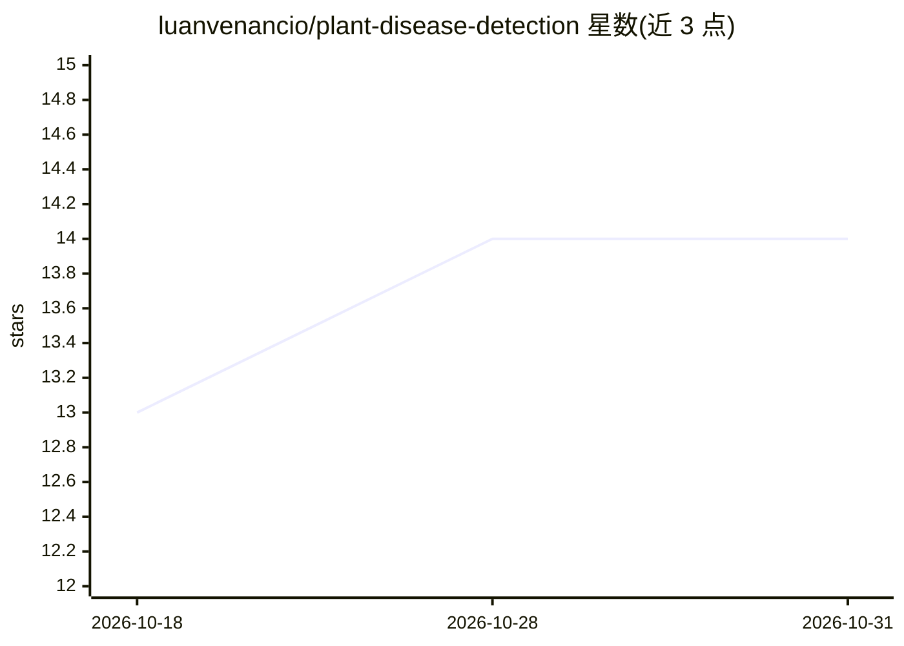

# luanvenancio/plant-disease-detection

⭐ 14 · TypeScript · 推送 2026-08-05 · [GitHub](https://github.com/luanvenancio/plant-disease-detection) · [官网](https://plant-disease-detection-two.vercel.app) · 个人维护

**基于 Vision Transformer 的植物病害图像检测 Web 应用**

用 React/Next.js 构建的植物病害诊断网站：用户上传植物叶片等图片，系统通过自训的 Vision Transformer 模型（PlantXViT，基于 Microsoft Swin Transformer V2 Tiny 微调）识别病害类别并给出置信度。模型托管在 Hugging Face，推理通过 Hugging Face API 与 Transformers 库完成。面向农业种植者与相关用户，本地运行需 Node.js 环境，克隆仓库后 npm install 并 npm run dev 启动。

## 筛选速览

| 维度 | 判定 | 备注 |
|---|---|---|
| AI 角色 | `ai-native` | 本体是模型或模型工具 |
| 许可风险 | `none` | — |
| 部署形态 | `library` | 以包/库形式分发 |
| 模型依赖 | — | README 未给出锁定关系 |
| 硬件要求 | — | 无带数字的原话,不猜 |
| 安装摩擦 | `low` | 无编译、无系统依赖或容器化 |
| 成熟度 | — | 结构信号不足 |

## 能力要点

- 自训 ViT 模型（基于 Swin Transformer V2 Tiny）识别多种作物病害
- 上传图片后展示病害类别与置信度
- 通过 Hugging Face API 加载模型与推理

## 适用场景

- 上传叶片照片快速诊断植物病害
- 查看病害类别判定及其置信度
- 开发者克隆源码在本地运行检测界面

## 场景标签

`目标检测` · 领域:感知与多模态

## 证据(README 行号)

> L6: This open-source project aims to create a web-based platform for detecting plant diseases using cutting-edge machine
> L12:  - We’ve trained our own Vision Transformer model specifically for plant disease identification. This model combine

## 星数曲线

2026-10-18 13 → 2026-10-31 14（+1）

---
*卡片 v1 · prompt 1.4 · 生成 2026-10-31 · 置信度 high · 依据 README sha `a042eaac3c0a` · [字段定义](../../DATASET.md)*
