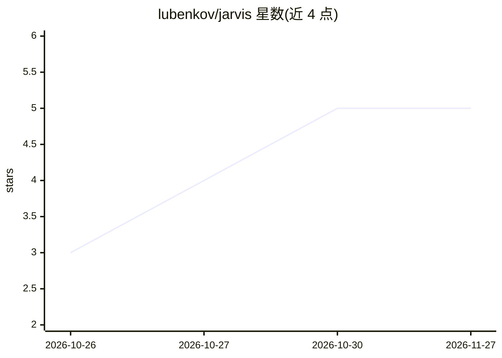

# lubenkov/jarvis

⭐ — · [GitHub]() · 个人维护

**从零实现的 138M 俄语 GPT 模型：训练、分词与本地推理全套**

以 PyTorch 从零实现的 decoder-only Transformer（138.4M 参数，RoPE/RMSNorm/SwiGLU，1024 上下文），面向俄语文本与对话。仓库包含自定义字节级 BPE 分词器、语料准备（FineWeb-2/Wikipedia/Gazeta 及多个俄语对话集）、预训练+SFT 两阶段训练管线（AMP、DDP、断点续训）、本地 KV-cache 推理、终端聊天与可选 Telegram bot。权重发布在 Hugging Face，仓库不包含权重；BPC 基准结果随仓库提交。作者声明其为实验性模型，非通用助手。

## 筛选速览

| 维度 | 判定 | 备注 |
|---|---|---|
| AI 角色 | `ai-native` | 本体是模型或模型工具 |
| 许可风险 | `permissive` | — |
| 部署形态 | `library` | 以包/库形式分发 |
| 模型依赖 | — | README 未给出锁定关系 |
| 硬件要求 | — | 无带数字的原话,不猜 |
| 安装摩擦 | `medium` | 含编译或系统依赖之一 |
| 成熟度 | — | 结构信号不足 |

## 能力要点

- 138M 参数 decoder-only Transformer，含模型/分词器/训练/评测全套代码
- 两阶段管线：预训练 + 对话 SFT（assistant-only loss mask）
- 本地推理带 KV cache，支持温度/top-k/top-p/重复惩罚配置
- BPC 基准对比 gzip/xz 基线，结果随仓库提交

## 适用场景

- 从零学习 GPT 风格模型的完整训练流程
- 训练自己的小型俄语对话模型
- 在本地终端或 Telegram 上运行自训练语言模型

## 场景标签

`模型训练` · 领域:训练与推理

## 证据(README 行号)

> L3: A 138M-parameter GPT-style language model for Russian, implemented from scratch in PyTorch — with a custom BPE token
> L12: `jarvis` is a compact, decoder-only Transformer focused primarily on Russian text and dialogue. The repository cont

## 星数曲线

2026-10-26 3 → 2026-11-27 5（+2）

---
*卡片 v1 · prompt 1.4 · 生成 2026-11-21 · 置信度 mid · 依据 README sha `4cc45052ed1e` · [字段定义](../../DATASET.md)*
