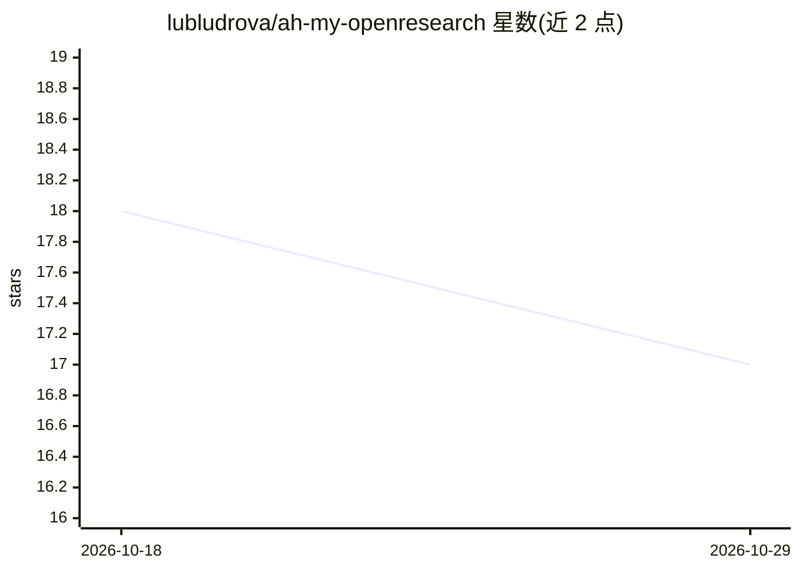

# lubludrova/ah-my-openresearch

⭐ 17 · TypeScript · MIT · 推送 2026-06-11 · [GitHub](https://github.com/lubludrova/ah-my-openresearch) · [官网](https://www.npmjs.com/package/ah-my-openresearch) · 个人维护

**把 OpenCode 变成文件化研究实验室的插件层**

基于 OpenCode 的研究记录层插件：提供 6 个研究人格（编排、文献、选题、编码、评审、写作）、17 个捆绑技能、项目级 lab/ 目录（claim/idea/exp 类型化草稿与 edges.jsonl 关系图）以及可选的 Obsidian 文献 wiki。产出为可检查、可 diff、可提交的 Markdown/JSONL 文件；agent 写草稿、用户审阅，写入范围受 hook 白名单限制。面向 ML/RL 研究者与工程师，自称早期软件，不支持 SaaS 看板或一键论文生成。

## 筛选速览

| 维度 | 判定 | 备注 |
|---|---|---|
| AI 角色 | `ai-ecosystem` | LLM/agent 周边工具 |
| 许可风险 | `permissive` | MIT |
| 部署形态 | `None` |  |
| 模型依赖 | — | README 未给出锁定关系 |
| 硬件要求 | — | 无带数字的原话,不猜 |
| 安装摩擦 | `low` | 无编译、无系统依赖或容器化 |
| 成熟度 | `idea` | |

## 能力要点

- 6 个研究人格与 17 个 SKILL.md 技能，编排者生成任务图并按波次分发
- lab/ 中类型化草稿 + edges.jsonl 的 claim/idea/experiment 关系记录
- @council 多模型对抗性评审，返回确定性 PASS/WARN/FAIL
- amore doctor 校验 lab 结构、技能与插件接线

## 适用场景

- 文献阅读时抽取 claim 并沉淀到可长期维护的 wiki
- 把假设、实验计划与结果关联成可追溯的研究记录
- 用多模型评审委员会筛选实验方案

## 场景标签

`科研工具` · 领域:学习与行业

## 证据(README 行号)

> L13: `amore` is a research-lab layer for
> L20: It is a durable research-record layer for agent-assisted ML/DL research.
> L52: - **Not model lock-in.** Personas route across the providers you use in OpenCode.

## 星数曲线

2026-10-18 18 → 2026-10-29 17（-1）

---
*卡片 v1 · prompt 1.4 · 生成 2026-10-29 · 置信度 high · 依据 README sha `c9c09f7d738d` · [字段定义](../../DATASET.md)*
