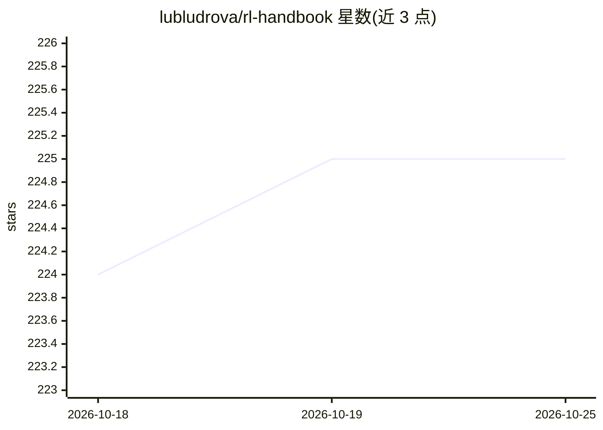

# lubludrova/rl-handbook

⭐ 226 · MDX · MIT · 推送 2026-10-23 · [GitHub](https://github.com/lubludrova/rl-handbook) · [官网](https://rl-handbook.com) · 个人维护 · 中文 README

**强化学习与序贯决策的开放手册：从入门到进阶**

用 Next.js/MDX 构建的开放在线手册，系统讲解强化学习与序贯决策：从多臂老虎机和马尔可夫决策过程开始，覆盖价值方法（Q-Learning、DQN 及改进）、策略梯度、Actor-Critic、TRPO、PPO、DDPG、TD3/SAC 等，进阶主题含模仿学习、离线 RL、好奇心驱动探索与多智能体。章节为自包含文件夹，含 MDX 源文、可运行示例与图表；Model-Based 与 Advanced Topics 部分标注待完成。面向学生、研究者与工程师，提供中英双语在线阅读。

## 筛选速览

| 维度 | 判定 | 备注 |
|---|---|---|
| AI 角色 | `ai-knowledge` | 知识聚合/清单类 |
| 许可风险 | `permissive` | MIT |
| 部署形态 | `None` |  |
| 模型依赖 | — | README 未给出锁定关系 |
| 硬件要求 | — | 无带数字的原话,不猜 |
| 安装摩擦 | `low` | 无编译、无系统依赖或容器化 |
| 成熟度 | — | 结构信号不足 |

## 能力要点

- 覆盖 bandit→价值方法→策略梯度→离线 RL 的章节体系
- 每章自包含：MDX 源文、可运行 Python 示例与图表
- 中英双语在线阅读，MIT 许可开源

## 适用场景

- 系统学习强化学习从基础到策略梯度方法
- 查找带可运行代码示例的算法讲解（如 PPO、DQN、SAC）
- 作为持续更新的领域参考资料

## 场景标签

`教程课程` `强化学习` · 领域:学习与行业

## 证据(README 行号)

> L17: This handbook gives a comprehensive, up-to-date guide to reinforcement learning and sequential decision making. Sta
> L60: Each chapter is a self-contained folder under `content/docs/<section>/<chapter>/` holding its MDX source, runnable 

## 星数曲线

2026-10-18 224 → 2026-10-25 225（+1）

---
*卡片 v1 · prompt 1.4 · 生成 2026-10-22 · 置信度 high · 依据 README sha `7499f90e57fd` · [字段定义](../../DATASET.md)*
