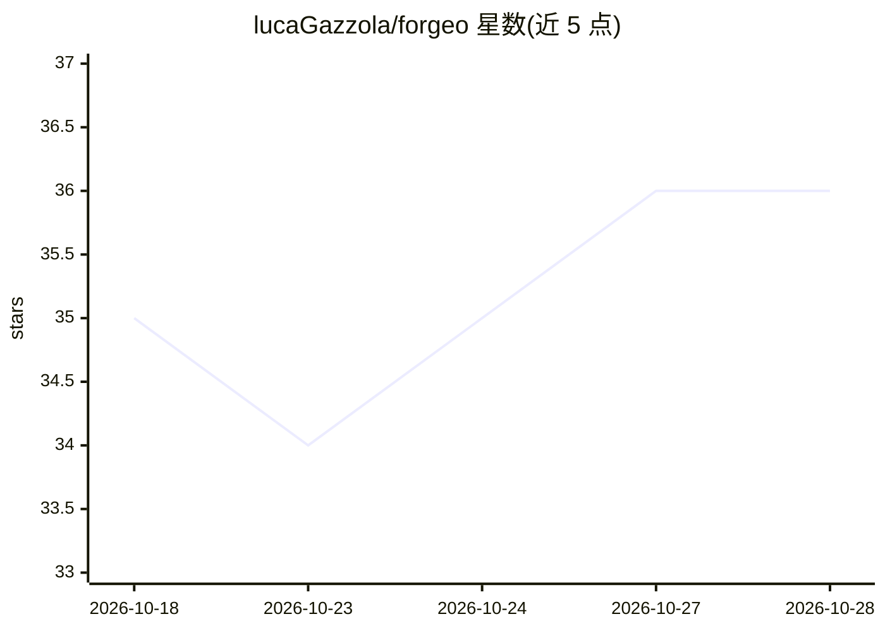

# lucaGazzola/forgeo

⭐ 36 · Python · MIT · 推送 2026-09-30 · [GitHub](https://github.com/lucaGazzola/forgeo) · [官网](https://forgeo.org) · 个人维护

**给编码 agent 的调度工厂：按 JSON backlog 自动跑任务并提交**

Forgeo 是一个基于终端的自动化流水线工具：读取纯 JSON 或 GitHub/GitLab/Jira/HTTP 来源的 backlog，按依赖关系挑选下一个可运行任务，调用任意编码 agent CLI（如 Claude Code、aider、自定义脚本，通过 FORGEO_TASK 环境变量传递任务），完成后提交到 main 分支；backlog 为空时自动执行重构。支持 Docker 沙箱隔离运行、多仓库多实例管理、Web 仪表盘、BLOCKED/FAILED 状态处理与 Telegram/webhook 通知。可选 review 分支模式等待人工合并。

## 筛选速览

| 维度 | 判定 | 备注 |
|---|---|---|
| AI 角色 | `ai-ecosystem` | LLM/agent 周边工具 |
| 许可风险 | `permissive` | MIT |
| 部署形态 | `library` | 以包/库形式分发 |
| 模型依赖 | — | README 未给出锁定关系 |
| 硬件要求 | — | 无带数字的原话,不猜 |
| 安装摩擦 | `low` | 无编译、无系统依赖或容器化 |
| 成熟度 | — | 结构信号不足 |

## 能力要点

- 依赖感知的任务挑选与定时循环调度（daemon）
- agent 无关：任何读取 FORGEO_TASK 的 CLI 均可接入
- backlog 为空时自动执行重构 pass
- Docker 沙箱隔离、多实例聚合 Web 仪表盘

## 适用场景

- 让编码 agent 按 backlog 自动逐个完成任务并提交
- 把 GitHub/Jira issue 同步为任务队列持续消化
- 多仓库统一 dashboard 管理自动化编码流水线

## 场景标签

`工作流自动化` · 领域:效率与自动化

## 证据(README 行号)

> L10: **Forgeo is a software factory for your coding agent.**
> L12: Give it a backlog and an agent CLI — Forgeo picks the next runnable task, runs the agent, and commits the result. I
> L15: - **Agent-agnostic** — any CLI that reads `FORGEO_TASK` (aider, Claude, custom script).

## 星数曲线

2026-10-18 35 → 2026-10-28 36（+1）

---
*卡片 v1 · prompt 1.4 · 生成 2026-10-25 · 置信度 mid · 依据 README sha `06c80e0c6027` · [字段定义](../../DATASET.md)*
