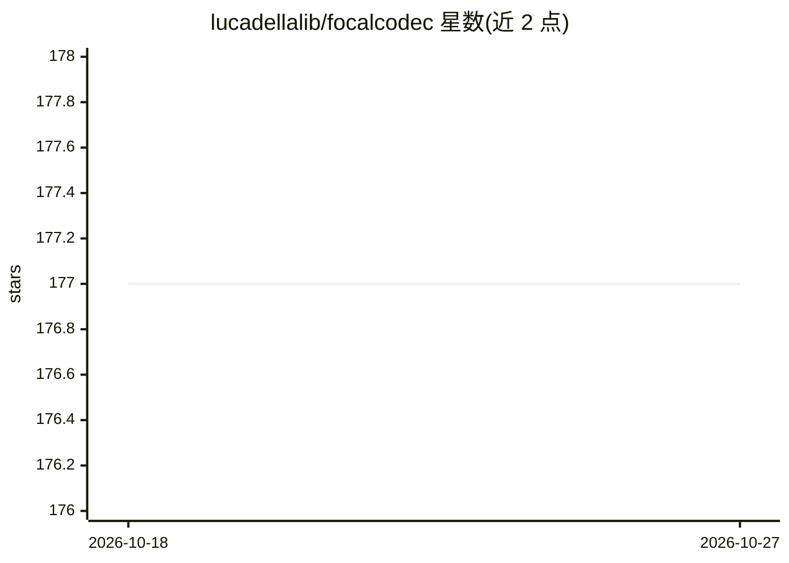

# lucadellalib/focalcodec

⭐ 177 · Jupyter Notebook · Apache-2.0 · 推送 2025-11-30 · [GitHub](https://github.com/lucadellalib/focalcodec) · [官网](https://lucadellalib.github.io/focalcodec-web/) · 个人维护

**低码率单码本神经语音编解码器，供语音处理研究使用**

基于焦点调制网络的 16/24 kHz 低码率语音编解码器，单码本设计，提供 0.16-0.80 kbps 的多个检查点，支持流式推理（因果蒸馏，延迟 80ms）、语音重合成、语音转换、ONNX 导出与麦克风实时输入。论文被 NeurIPS 2025 接收，另有 FocalCodec-Stream 预印本。可通过 torch.hub 直接加载或 pip 从 git 安装，训练配方发布于 SpeechBrain。

## 筛选速览

| 维度 | 判定 | 备注 |
|---|---|---|
| AI 角色 | `ai-native` | 本体是模型或模型工具 |
| 许可风险 | `permissive` | Apache-2.0 |
| 部署形态 | `library` | 以包/库形式分发 |
| 模型依赖 | — | README 未给出锁定关系 |
| 硬件要求 | — | 无带数字的原话,不猜 |
| 安装摩擦 | `low` | 无编译、无系统依赖或容器化 |
| 成熟度 | `idea` | |

## 能力要点

- 单码本向量量化，码率 0.16-0.80 kbps（50/25/12.5 Hz token 率）
- 流式推理支持，因果检查点延迟 80ms
- 语音重合成与语音转换 demo，支持麦克风实时输入
- 实验性 ONNX 导出，训练配方发布于 SpeechBrain

## 适用场景

- 为语音合成/语音转换任务提取离散 token
- 低带宽场景下的语音编码与重建
- 研究流式低延迟语音编解码

## 场景标签

 · 领域:语音处理/神经编解码

## 证据(README 行号)

> L6: A low-bitrate single-codebook 16 / 24 kHz speech codec based on focal modulation.
> L166: @inproceedings{dellalibera2025focalcodec,

## 星数曲线

2026-10-18 177 → 2026-10-27 177（+0）

---
*卡片 v1 · prompt 1.4 · 生成 2026-10-22 · 置信度 high · 依据 README sha `9b24fefbf6ac` · [字段定义](../../DATASET.md)*
