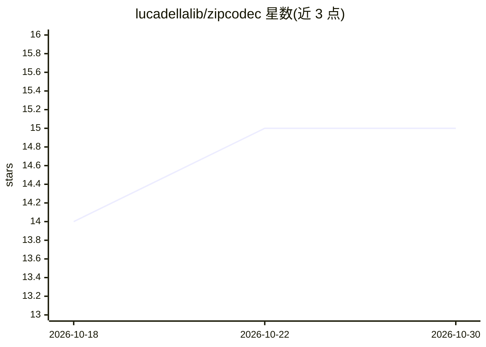

# lucadellalib/zipcodec

⭐ 15 · Python · Apache-2.0 · 推送 2026-09-11 · [GitHub](https://github.com/lucadellalib/zipcodec) · [官网](https://lucadellalib.github.io/zipcodec-web/) · 个人维护

**6.25 Hz 低码率流式神经音频编解码器，基于 WavLM**

PyTorch 实现的流式神经音频编解码模型：以 16 kHz 采样率、6.25 Hz 帧率、0.80 kbps 码率对语音编码与重建，支持流式与离线执行、ONNX/OpenVINO CPU 推理、麦克风实时流、帧级 kNN 语音转换，并提供 step/step_desync 分块推理接口用于连续批处理。842M 参数的预训练检查点经 PyTorch Hub 与 Hugging Face Hub 分发。依赖仅 torch/numpy/safetensors/huggingface-hub，核心包另提供 pip 安装与 uv 锁定开发环境两种方式。

## 筛选速览

| 维度 | 判定 | 备注 |
|---|---|---|
| AI 角色 | `ai-native` | 本体是模型或模型工具 |
| 许可风险 | `permissive` | Apache-2.0 |
| 部署形态 | `library` | 以包/库形式分发 |
| 模型依赖 | local-ok | 支持本地模型 |
| 硬件要求 | — | 无带数字的原话,不猜 |
| 安装摩擦 | `medium` | 含编译或系统依赖之一 |
| 成熟度 | — | 结构信号不足 |

## 能力要点

- 6.25 Hz 帧率、0.80 kbps 码率的流式编码（842M 参数，64×4 codebooks）
- 提供 step / step_desync 分块流式接口，支持连续批处理
- ONNX / OpenVINO / JIT / compile 多后端推理与麦克风实时流
- 帧级 kNN 语音转换（基于 WavLM6 目标特征池）

## 适用场景

- 极低码率语音压缩与重建
- 为 TTS/语音任务提取 6.25 Hz 量化 token 特征
- 麦克风输入的实时流式编解码与在线语音转换

## 场景标签

 · 领域:语音/音频 AI

## 证据(README 行号)

> L7: A 6.25 Hz, 0.80 kbit/s streaming neural audio codec based on WavLM.
> L129: |lucadellalib/zipcodec|842M|16 kHz|6.25 Hz|64 × 4|0.80 kbps|✅|

## 星数曲线

2026-10-18 14 → 2026-10-30 15（+1）

---
*卡片 v1 · prompt 1.4 · 生成 2026-10-30 · 置信度 high · 依据 README sha `53b1fc0c40a9` · [字段定义](../../DATASET.md)*
