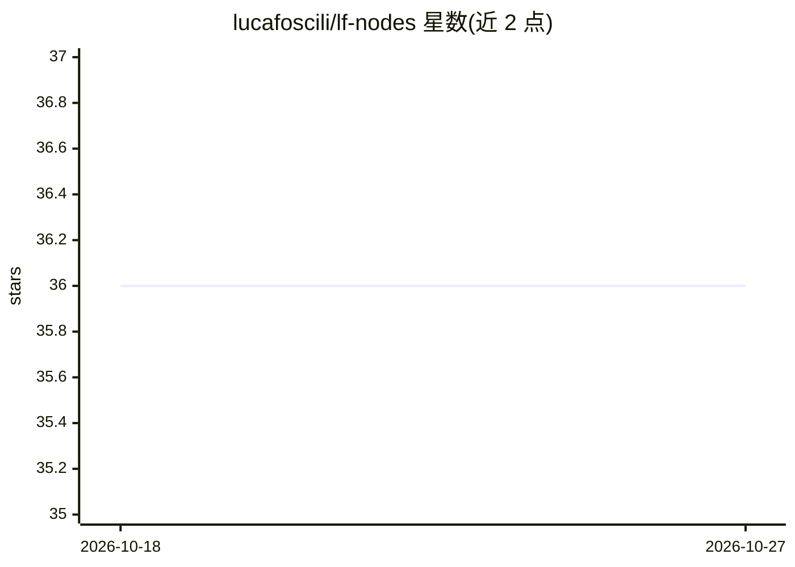

# lucafoscili/lf-nodes

⭐ 36 · Python · MIT · 推送 2026-10-02 · [GitHub](https://github.com/lucafoscili/lf-nodes) · 个人维护

**ComfyUI 自定义节点套件：交互式图像编辑、LLM 节点与工作流工具**

面向 ComfyUI 用户的自定义节点套件，基于 Stencil.js 的 LF Widgets webcomponents 提供前端交互组件。功能覆盖分析统计、CivitAI 元数据管理、图像/潜空间处理、JSON 操作、带历史记录的原语节点、图像加载与编辑（inpaint、亮度/对比度等）、可视化小说叙事图，以及连接本地运行 LLM 的 Messenger 节点（测试于 Koboldcpp，兼容免鉴权 OpenAI 兼容端点）。另含默认关闭的 Workflow Runner miniapp，可注册 HTTP 路由运行工作流。支持 ComfyUI Manager、ZIP 或 git clone 安装。

## 筛选速览

| 维度 | 判定 | 备注 |
|---|---|---|
| AI 角色 | `ai-ecosystem` | LLM/agent 周边工具 |
| 许可风险 | `permissive` | MIT |
| 部署形态 | `desktop` | 安装包/桌面程序 |
| 模型依赖 | — | README 未给出锁定关系 |
| 硬件要求 | — | 无带数字的原话,不猜 |
| 安装摩擦 | `low` | 无编译、无系统依赖或容器化 |
| 成熟度 | — | 结构信号不足 |

## 能力要点

- 交互式图像编辑节点 LF_LoadAndEditImages（inpaint、饱和度、亮度、对比度）
- LLM 节点对接本地运行 LLM，Messenger 节点含角色管理
- Workflow Runner miniapp 支持外部工作流注册与结构预检脚本
- 前端组件来自 LF Widgets webcomponents 库

## 适用场景

- 在 ComfyUI 工作流中进行工作流内的图像编辑
- 用本地 LLM 搭建对话/角色节点参与生成流程
- 管理与展示 CivitAI 模型元数据
- 以 Workflow Runner 将 ComfyUI 工作流封装为可复用 miniapp

## 场景标签

`图像生成` · 领域:内容生成

## 证据(README 行号)

> L11: A suite of custom nodes for ComfyUI aimed at enhancing user experience with more interactive and visually engaging 
> L26: - **LLM nodes**: Interface with locally running LLMs, like the Messenger node, which also manages characters.
> L174: The LLM nodes were tested with Koboldcpp, but any Open AI-compatible endpoint that does not require authentication

## 星数曲线

2026-10-18 36 → 2026-10-27 36（+0）

---
*卡片 v1 · prompt 1.4 · 生成 2026-10-25 · 置信度 mid · 依据 README sha `1161f948db74` · [字段定义](../../DATASET.md)*
