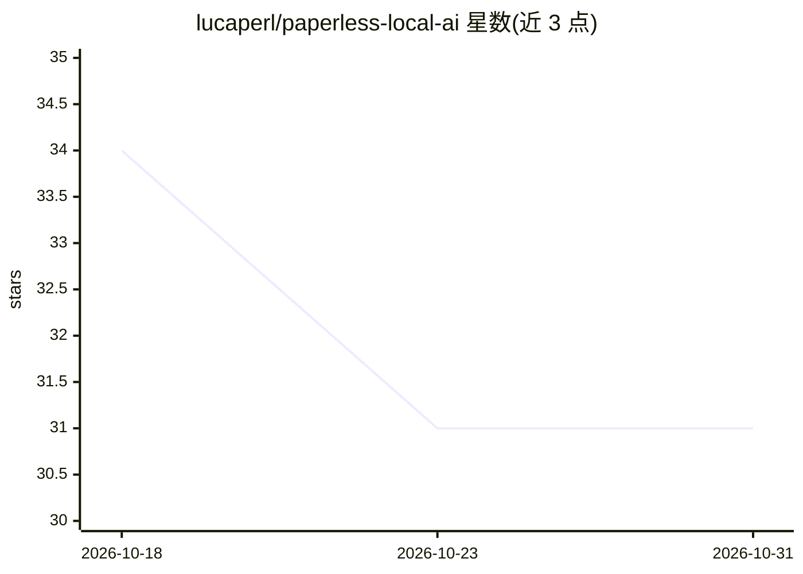

# lucaperl/paperless-local-ai

⭐ 31 · Python · MIT · 推送 2026-10-17 · [GitHub](https://github.com/lucaperl/paperless-local-ai) · [官网](https://lucaperl.github.io/paperless-local-ai/) · 个人维护

**为 Paperless-ngx 提供本地 OCR、元数据自动化与文档对话的 AI 插件**

围绕已有 Paperless-ngx 部署运行的本地 AI 工作流管理组件：用 PaddleOCR（PP-OCRv6）处理需要 OCR 的扫描页，用本地 LLM 一次性生成标题、文档类型、日期与通信方，并支持 Hybrid/直连两种标签策略；在 Paperless 界面内提供持久多轮文档对话（RAG，SQLite 索引+本地余弦检索）。设计面向 CPU-only 自托管服务器：同一时间只运行一个重任务，模型用完即卸载。通过 Docker Compose 或 TrueNAS SCALE 部署，需配合 Paperless-ngx 与独立运行的 Ollama；Control Center 无内置认证，README 注明项目为 vibe-coded、可能存在 bug。

## 筛选速览

| 维度 | 判定 | 备注 |
|---|---|---|
| AI 角色 | `ai-ecosystem` | LLM/agent 周边工具 |
| 许可风险 | `permissive` | MIT |
| 部署形态 | `self-host` | docker 或自建部署 |
| 模型依赖 | local-ok | 支持本地模型 |
| 硬件要求 | `cpu-ok` | |
| 安装摩擦 | `low` | 无编译、无系统依赖或容器化 |
| 成熟度 | `idea` | |

## 能力要点

- PaddleOCR PP-OCRv6 扫描 OCR（Medium/Small/Tiny 质量档）
- 单次结构化模型请求生成标题/类型/日期/通信方，Hybrid 标签可复用已审核历史
- Paperless 界面内持久多轮 RAG 文档对话，回答附来源文档链接
- CPU-only 设计：任务串行、模型卸载、空载占用约 18.6 MiB RAM

## 适用场景

- 自建 Paperless 文档库的扫描件 OCR 与自动分类打标
- 在 Paperless 内对单个文档或全库做带出处的问答
- 无 GPU 的家用服务器上运行文档 AI 工作流

## 场景标签

`OCR` `RAG` `文档问答` · 领域:知识与检索

## 证据(README 行号)

> L20: Paperless remains the document system of record, and Ollama remains a separate service. `paperless-local-ai` manage
> L8: `paperless-local-ai` works alongside an existing Paperless-ngx installation. It improves scan OCR with PaddleOCR, cl
> L83: Paperless-ngx already provides optional AI features and can use local Ollama. PLAI is built around two additional p

## 星数曲线

2026-10-18 34 → 2026-10-31 31（-3）

---
*卡片 v1 · prompt 1.4 · 生成 2026-10-26 · 置信度 high · 依据 README sha `086dbd368243` · [字段定义](../../DATASET.md)*
