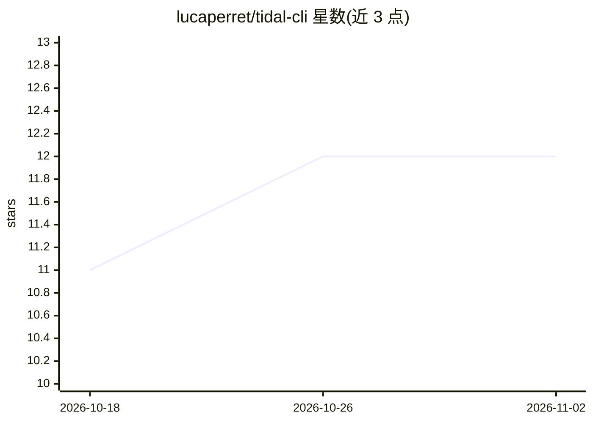

# lucaperret/tidal-cli

⭐ 12 · TypeScript · MIT · 推送 2026-07-01 · [GitHub](https://github.com/lucaperret/tidal-cli) · [官网](https://tidal-cli.lucaperret.ch) · 个人维护

**终端控制 Tidal 音乐服务的 CLI，面向脚本与 LLM agent**

将 Tidal API v2 封装为单一命令行工具：搜索目录、播放列表 CRUD、曲库管理、播放（含 LOSSLESS/HI_RES 音质）、个性化推荐、分享链接等，每条命令支持 --json 输出。除 CLI 外，还以远程 MCP server 形式提供给 Claude Desktop/Smithery（40 个工具、OAuth 认证、3 个 prompt 模板），并作为 OpenClaw skill 发布于 ClawHub。运行需 Node.js ≥ 20 与 Tidal 账户，认证后 agent 可非交互执行命令并自动刷新 token。

## 筛选速览

| 维度 | 判定 | 备注 |
|---|---|---|
| AI 角色 | `ai-enhanced` | 去掉 AI 部分产品仍成立 |
| 许可风险 | `permissive` | MIT |
| 部署形态 | `library` | 以包/库形式分发 |
| 模型依赖 | locked-api |  |
| 硬件要求 | — | 无带数字的原话,不猜 |
| 安装摩擦 | `low` | 无编译、无系统依赖或容器化 |
| 成熟度 | — | 结构信号不足 |

## 能力要点

- 每条命令支持 --json 输出，供脚本与 agent 使用
- 远程 MCP server（40 工具、OAuth、安全标注）接入 Claude Desktop/Smithery
- OpenClaw skill 可通过 clawhub install 安装
- 覆盖播放列表 CRUD、曲库、推荐、播放、分享等 Tidal 功能

## 适用场景

- 在终端用命令管理 Tidal 播放列表与曲库
- 让 AI agent 通过自然语言指令操作 Tidal（建歌单、找相似艺人）
- 在 shell 脚本中用 jq 处理 JSON 输出实现搜索即行动

## 场景标签

 · 领域:音乐/开发者工具

## 证据(README 行号)

> L15: tidal-cli wraps the Tidal API v2 into a single command-line tool. Search the catalog, manage playlists, explore art
> L144: tidal-cli is available as a remote MCP server for Claude Desktop, Smithery, and any MCP-compatible client.

## 星数曲线

2026-10-18 11 → 2026-11-02 12（+1）

---
*卡片 v1 · prompt 1.4 · 生成 2026-11-01 · 置信度 high · 依据 README sha `36dfb5767231` · [字段定义](../../DATASET.md)*
