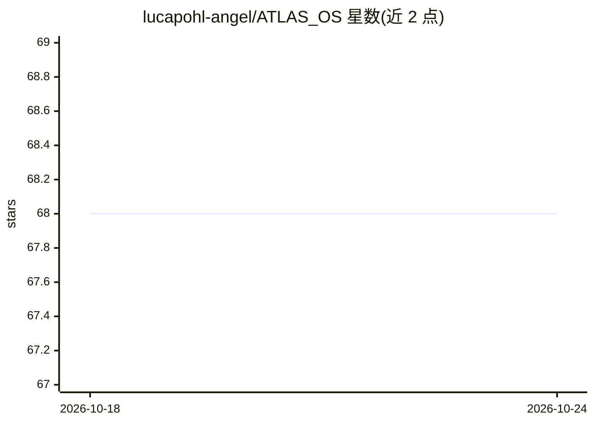

# lucapohl-angel/ATLAS_OS

⭐ 68 · TypeScript · MIT · 推送 2026-05-15 · [GitHub](https://github.com/lucapohl-angel/ATLAS_OS) · [官网](https://atlas-os.dev) · 个人维护

**多 agent 终端工程 CLI：一个提示从需求到发布全流程**

面向开发者的 hook 驱动多 agent 终端工程系统：以希腊神谱命名专职 agent（Athena 写 PRD、Prometheus 定架构、Hestia 拆故事、Hercules 实现、Nemesis QA、Iris 发布），组成规格驱动开发流水线。支持类型化工具、TypeScript 生命周期 hook、MCP 服务器集成、技能加载与持久化项目状态。模型接入覆盖 Anthropic、OpenAI、OpenRouter、OpenCode Zen/Go，并兼容 Ollama、LM Studio、vLLM、llama.cpp 的 OpenAI 兼容接口。通过 npx/npm 安装，提供全屏 TUI，macOS/Linux/Windows(WSL2) 可用，另含 VS Code 扩展；本地模型按 Lite/Hybrid/Full 模式分级。

## 筛选速览

| 维度 | 判定 | 备注 |
|---|---|---|
| AI 角色 | `ai-ecosystem` | LLM/agent 周边工具 |
| 许可风险 | `permissive` | MIT |
| 部署形态 | `library` | 以包/库形式分发 |
| 模型依赖 | local-ok | 支持本地模型 |
| 硬件要求 | — | 无带数字的原话,不猜 |
| 安装摩擦 | `low` | 无编译、无系统依赖或容器化 |
| 成熟度 | — | 结构信号不足 |

## 能力要点

- 六个专职 agent 组成 PRD→架构→故事→实现→QA→发布流水线
- 类型化 TypeScript 生命周期 hook 与 MCP（stdio + Streamable HTTP）集成
- 模型接入含 Anthropic/OpenAI/OpenRouter 及本地 Ollama/LM Studio/vLLM/llama.cpp
- 本地模型分 Lite/Hybrid/Full 三档工具模式

## 适用场景

- 在终端用一个提示从想法推进到可发布的功能
- 在已有仓库中用 /onboard 理解代码后做窄范围修改并跑验证
- 用本地 Ollama 模型在低显存环境下开发代码

## 场景标签

`多智能体` `编码 Agent` · 领域:Agent 开发

## 证据(README 行号)

> L5: A multi-agent, hook-driven, model-agnostic engineering OS for the terminal.
> L35: the engine serious: multi-agent orchestration, typed tools, hook-based safety,
> L160: Local OpenAI-compatible servers work too. Atlas auto-detects Ollama at

## 星数曲线

2026-10-18 68 → 2026-10-24 68（+0）

---
*卡片 v1 · prompt 1.4 · 生成 2026-10-24 · 置信度 high · 依据 README sha `d8b3957cef77` · [字段定义](../../DATASET.md)*
