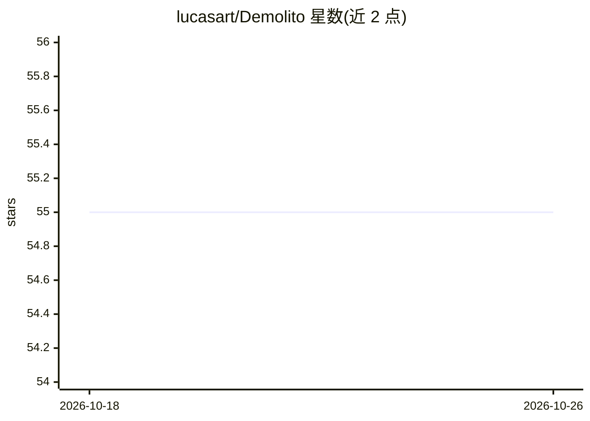

# lucasart/Demolito

⭐ 55 · C · GPL-3.0 · 推送 2025-12-16 · [GitHub](https://github.com/lucasart/Demolito) · 个人维护

**C 语言编写的 UCI 国际象棋引擎，供 GUI 调用对弈**

Demolito 是用 C 编写的 UCI 协议命令行国际象棋引擎，不直接面向用户，需通过 CuteChess、Banksia 或 c-chess-cli 等 UCI 界面使用。默认满强度适合引擎对弈，提供 Level（1-12 级，非确定性）、Contempt、Hash、Threads（SMP 多线程搜索）、UCI_Chess960 等 UCI 选项。Windows 提供自动编译的 pext/popcnt/no_popcnt 三种二进制；其他平台需用 clang/gcc + make 从源码编译，附带 bench 基准与 seal 签名校验。

## 筛选速览

| 维度 | 判定 | 备注 |
|---|---|---|
| AI 角色 | `ai-native` | 本体是模型或模型工具 |
| 许可风险 | `viral` | GPL-3.0 |
| 部署形态 | `desktop` | 安装包/桌面程序 |
| 模型依赖 | — | README 未给出锁定关系 |
| 硬件要求 | — | 无带数字的原话,不猜 |
| 安装摩擦 | `medium` | 含编译或系统依赖之一 |
| 成熟度 | — | 结构信号不足 |

## 能力要点

- UCI 协议引擎，经 CuteChess/Banksia 等 GUI 使用
- Level 1-12 限档选项，带非确定性与 Fake Time 拟人思考
- 支持 SMP 多线程搜索与 Chess960 规则
- Windows 自动编译二进制（pext/popcnt/no_popcnt 按硬件选择）

## 适用场景

- 通过 UCI 界面与引擎对弈或进行引擎间比赛
- 参加 FGRL/CEGT/CCRL 等等级分测试
- 研究国际象棋搜索算法的 C 实现

## 场景标签

 · 领域:游戏/棋类引擎

## 证据(README 行号)

> L3: Demolito is a UCI
> L5: a command line program, which is not designed to be used directly, but instead through an UCI capable

## 星数曲线

2026-10-18 55 → 2026-10-26 55（+0）

---
*卡片 v1 · prompt 1.4 · 生成 2026-10-24 · 置信度 mid · 依据 README sha `e422ddd07274` · [字段定义](../../DATASET.md)*
