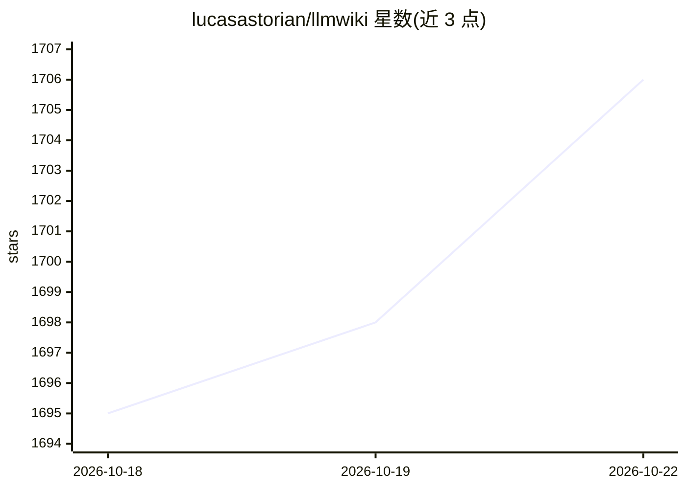

# lucasastorian/llmwiki

⭐ 1,706 · Python · Apache-2.0 · 推送 2026-10-20 · [GitHub](https://github.com/lucasastorian/llmwiki) · [官网](https://llmwiki.app) · 个人维护

**AI 自主维护的个人维基：上传资料，Claude 经 MCP 自动撰写**

受 Karpathy LLM Wiki 概念启发的自维护知识库系统：用户上传 Markdown/PDF/Word/PowerPoint 等文档，或经 Chrome 扩展剪藏网页并添加高亮与批注；Claude 通过 MCP 协议读取、搜索并自动撰写带引用的维基页面，可设置 Claude Routine 定时夜间运行以持续更新。提供 Next.js Web 应用、图查看器与 SQLite 本地索引，本地模式仅监听回环地址；需 Python 3.11+、Node.js 20+，Office 文档解析依赖本地 LibreOffice。面向个人、组织及作为 LLM 上下文层三种规模。

## 筛选速览

| 维度 | 判定 | 备注 |
|---|---|---|
| AI 角色 | `ai-native` | 本体是模型或模型工具 |
| 许可风险 | `permissive` | Apache-2.0 |
| 部署形态 | `library` | 以包/库形式分发 |
| 模型依赖 | locked-api |  |
| 硬件要求 | — | 无带数字的原话,不猜 |
| 安装摩擦 | `low` | 无编译、无系统依赖或容器化 |
| 成熟度 | — | 结构信号不足 |

## 能力要点

- Claude 经 MCP 读取/搜索/撰写/编辑带引用的维基页面（11 个工具）
- Chrome 扩展剪藏网页与 PDF，保留高亮和批注
- 本地 SQLite+文件系统与托管 Postgres+S3 双后端架构（VaultFS 抽象）
- 支持 Claude Routine 定时自主维护，含 lint 引用与死链检查

## 适用场景

- 把日常阅读、笔记和剪藏自动整理成带引用的个人维基
- 为组织建立自维护的机构知识层
- 作为 LLM 的上下文层，让 AI 应用自己的思维模型协作

## 场景标签

`知识库管理` · 领域:知识与检索

## 证据(README 行号)

> L7: LLM Wiki transforms your scattered reading and research into a persistent, AI-maintained second brain. Capture docum
> L19: - **Connect via MCP** Connect Claude.ai, Claude Cowork, Claude Code, or Codex (or any other MCP-compatible app)
> L79: **3. Connect Claude over MCP.** MCP enables Claude to read, write, and search your wiki.

## 星数曲线

2026-10-18 1,695 → 2026-10-22 1,706（+11）

---
*卡片 v1 · prompt 1.4 · 生成 2026-10-21 · 置信度 high · 依据 README sha `781bdf5bcaad` · [字段定义](../../DATASET.md)*
