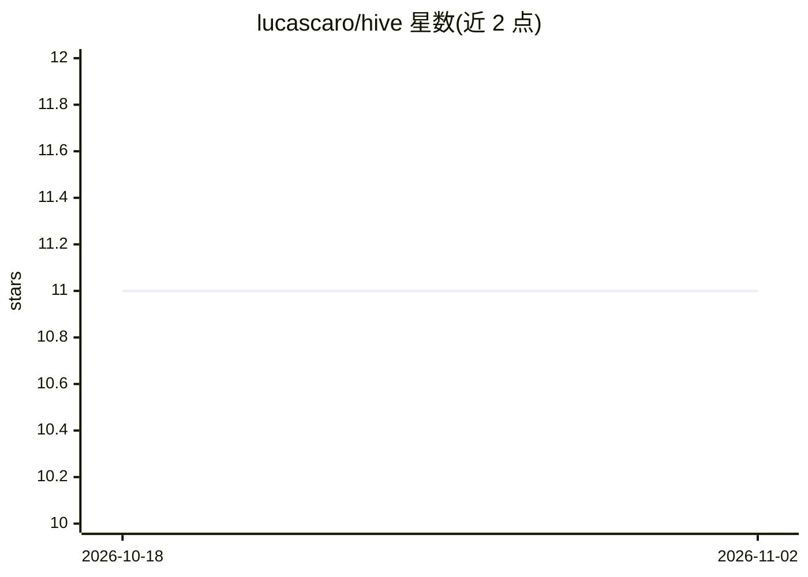

# lucascaro/hive

⭐ 11 · TypeScript · GPL-3.0 · 推送 2026-11-01 · [GitHub](https://github.com/lucascaro/hive) · [官网](https://lucascaro.github.io/hive/) · 个人维护

**管理多个 AI 编码 agent 会话的原生桌面 GUI**

基于 Wails 与 xterm.js 的原生桌面应用，配合多会话守护进程 hived，跨项目管理并启动多个 AI 编码 agent（Claude、Codex、Gemini、Copilot、Aider、Pi 及普通 shell）。关键机制：会话在 GUI 重启后持久保留；Claude/Pi 通过 hooks 与扩展上报工作/空闲/等待状态；ACP 协议会话以 transcript 形式呈现并支持权限审批；提供网格视图、多窗口、会话间消息、计划审查插件与想法收件箱。限制：平台安装器、Linux 应用内更新等尚未提供，需自行构建。

## 筛选速览

| 维度 | 判定 | 备注 |
|---|---|---|
| AI 角色 | `ai-ecosystem` | LLM/agent 周边工具 |
| 许可风险 | `viral` | GPL-3.0 |
| 部署形态 | `desktop` | 安装包/桌面程序 |
| 模型依赖 | locked-api |  |
| 硬件要求 | — | 无带数字的原话,不猜 |
| 安装摩擦 | `low` | 无编译、无系统依赖或容器化 |
| 成熟度 | — | 结构信号不足 |

## 能力要点

- 多会话守护进程 hived，会话跨 GUI 重启持久保留
- 支持 Claude/Codex/Gemini/Copilot/Aider/Pi/普通 shell 的 agent 启动器
- ACP 会话以 transcript 呈现，支持权限就地批准/拒绝与计划审查
- 会话间消息（hived msg）、hived wait 等跨 agent 协作命令

## 适用场景

- 同时跑多个 AI 编码 agent 并按项目组织会话
- 在一个窗口里观察各 agent 的工作/等待状态并处理权限请求
- 把笔记式想法转成带开场提示词的新 agent 会话

## 场景标签

 · 领域:开发者工具/AI agent 会话管理

## 证据(README 行号)

> L3: A native desktop app for managing multiple AI coding agent sessions —
> L12: - Multi-session daemon (`hived`) — sessions persist across GUI restart
> L16: - Agent launcher (Claude, Codex, Gemini, Copilot, Aider, Pi, shell) — hide the

## 星数曲线

2026-10-18 11 → 2026-11-02 11（+0）

---
*卡片 v1 · prompt 1.4 · 生成 2026-11-02 · 置信度 mid · 依据 README sha `14995e537f32` · [字段定义](../../DATASET.md)*
