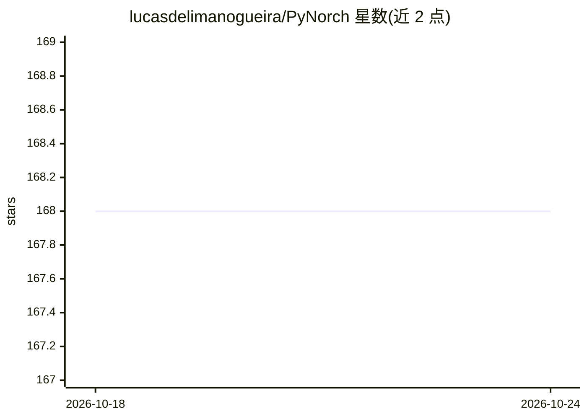

# lucasdelimanogueira/PyNorch

⭐ 168 · Python · 推送 2025-11-25 · [GitHub](https://github.com/lucasdelimanogueira/PyNorch) · 个人维护

**从零重写 PyTorch 的教学用深度学习框架**

个人教育项目，用 C/C++、CUDA 和 Python 从零实现深度学习框架：包含 Tensor 对象、自动微分系统、多 GPU 分布式训练（All-reduce、Broadcast、DistributedDataParallel）以及 nn/optim 模块。README 明确声明不与 PyTorch 竞争，目的仅是展示框架内部工作原理。通过 PyPI（pip install norch）或克隆源码安装，提供单 GPU 与多 GPU 训练示例，部分功能（Conv2d、内存管理等）仍在开发中。

## 筛选速览

| 维度 | 判定 | 备注 |
|---|---|---|
| AI 角色 | `ai-ecosystem` | LLM/agent 周边工具 |
| 许可风险 | `none` | — |
| 部署形态 | `library` | 以包/库形式分发 |
| 模型依赖 | — | README 未给出锁定关系 |
| 硬件要求 | — | 无带数字的原话,不猜 |
| 安装摩擦 | `medium` | 含编译或系统依赖之一 |
| 成熟度 | — | 结构信号不足 |

## 能力要点

- Tensor 对象与自动微分系统实现
- 多 GPU 分布式训练（All-reduce/Broadcast/DDP）
- pip install norch 即可安装，可在 Colab 测试
- 通过 python3 -m norch.distributed.run 启动多进程训练

## 适用场景

- 学习深度学习框架的内部实现机制
- 阅读 C/C++/CUDA 源码理解自动微分与分布式训练
- 在 Colab 或多 GPU 实例上运行教学示例

## 场景标签

`教程课程` · 领域:学习与行业

## 证据(README 行号)

> L7: **PyNorch** is a deep learning framework constructed using C/C++, CUDA and Python. This is a personal project with e
> L72: |Distributed|in progress|[X] All-reduce [X] Broadcast [X] DistributedSampler [X] DistributedDataParallel|

## 星数曲线

2026-10-18 168 → 2026-10-24 168（+0）

---
*卡片 v1 · prompt 1.4 · 生成 2026-10-22 · 置信度 high · 依据 README sha `18321f740545` · [字段定义](../../DATASET.md)*
