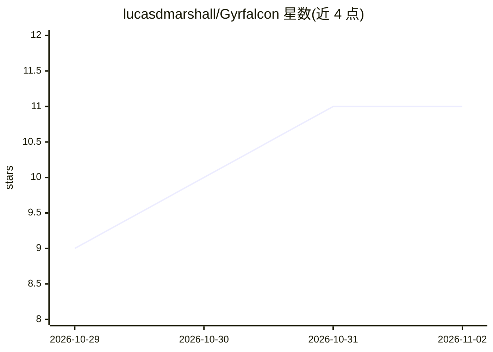

# lucasdmarshall/Gyrfalcon

⭐ 11 · Rust · Apache-2.0 · 推送 2026-11-01 · [GitHub](https://github.com/lucasdmarshall/Gyrfalcon) · 个人维护

**Rust 实现的嵌入式混合检索引擎：BM25+稠密向量融合**

面向 RAG 场景的混合检索引擎，在单一 Rust 嵌入式引擎中对同一分块同时执行 BM25 与稠密向量检索并融合打分。无需服务器、向量数据库或 GPU；默认 lite 层使用静态嵌入表（130MB 模型首次使用时下载），无需模型运行时，full 层通过 ONNX Runtime 运行 bge-small-en-v1.5。提供 Python、Rust、CLI 与 HTTP 四种接口，支持 PDF/HTML/Markdown 解析、元数据过滤、fsync 持久化写入与快照读。README 给出与 LlamaIndex/LangChain/Haystack 在 BEIR 数据集上的基准对比，并披露融合权重经调优的限制。

## 筛选速览

| 维度 | 判定 | 备注 |
|---|---|---|
| AI 角色 | `ai-ecosystem` | LLM/agent 周边工具 |
| 许可风险 | `permissive` | Apache-2.0 |
| 部署形态 | `library` | 以包/库形式分发 |
| 模型依赖 | — | README 未给出锁定关系 |
| 硬件要求 | — | 无带数字的原话,不猜 |
| 安装摩擦 | `low` | 无编译、无系统依赖或容器化 |
| 成熟度 | — | 结构信号不足 |

## 能力要点

- BM25 与稠密检索在同一分块上并行执行并按融合公式打分
- 无服务器、无向量数据库、无 GPU；默认 lite 层无需模型运行时
- Python/Rust/CLI/HTTP 四种接口打开同一 collection 格式
- 写入 fsync 持久化、原子更新、读快照不阻塞

## 适用场景

- 为 RAG 管线提供本地嵌入式混合检索，替代外部向量数据库
- 在小内存 CPU 机器上索引和检索大规模或频繁变更的语料
- 通过 LangChain/LlamaIndex 适配器接入既有 RAG 框架

## 场景标签

`RAG` `向量数据库` · 领域:知识与检索

## 证据(README 行号)

> L5: BM25 and dense vector search over the same chunks, fused, in one Rust engine.
> L74: Already using LangChain or LlamaIndex? A twenty-line adapter makes a collection their retriever:

## 星数曲线

2026-10-29 9 → 2026-11-02 11（+2）

---
*卡片 v1 · prompt 1.4 · 生成 2026-11-02 · 置信度 high · 依据 README sha `1962896b1fd2` · [字段定义](../../DATASET.md)*
