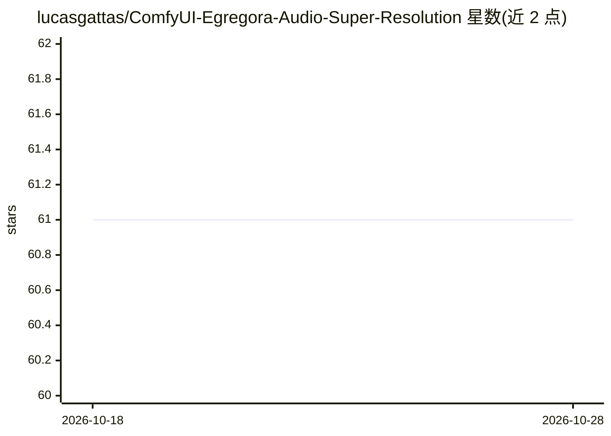

# lucasgattas/ComfyUI-Egregora-Audio-Super-Resolution

⭐ 61 · Python · MIT · 推送 2026-02-03 · [GitHub](https://github.com/lucasgattas/ComfyUI-Egregora-Audio-Super-Resolution) · [官网](https://egregoralabs.com) · 个人维护

**ComfyUI 音频增强节点包：超分辨率与频谱增强**

面向 ComfyUI 的音频处理节点集合，包含基于扩散模型的 FlashSR 音频超分辨率节点（内部重采样到 48 kHz，可输出 48000/44100/96000）、基于 CuPy 的 Fat Llama GPU 频谱增强节点及 FFTW CPU 版本，另有降噪/去混响 Extras（RNNoise、DeepFilterNet 2/3、WPE、DAC）与评测工具（LUFS 响度、ABX、Null Test、SI-SDR/LSD）。安装方式为复制目录到 custom_nodes 后用 ComfyUI 内嵌 Python 执行 pip 安装与 install.py；FlashSR 权重因许可限制不随包分发，需用户自行获取放入指定目录。

## 筛选速览

| 维度 | 判定 | 备注 |
|---|---|---|
| AI 角色 | `ai-native` | 本体是模型或模型工具 |
| 许可风险 | `permissive` | MIT |
| 部署形态 | `desktop` | 安装包/桌面程序 |
| 模型依赖 | — | README 未给出锁定关系 |
| 硬件要求 | — | 无带数字的原话,不猜 |
| 安装摩擦 | `medium` | 含编译或系统依赖之一 |
| 成熟度 | — | 结构信号不足 |

## 能力要点

- FlashSR 扩散模型音频超分辨率节点（48 kHz 内部重采样，输出采样率可选）
- Fat Llama 频谱增强含 GPU（CuPy）与 CPU（FFTW）两条路径
- 降噪/去混响链（RNNoise、DeepFilterNet 2/3、WPE、DAC）
- 评测工具：LUFS 响度、ABX、Null Test（GCC-PHAT 对齐）、SI-SDR/LSD

## 适用场景

- 在 ComfyUI 工作流中对低质量音乐做超分辨率与频谱增强
- 为压缩或含噪音频做降噪、去混响预处理后再增强
- 用 ABX、Null Test、响度指标验证增强前后差异

## 场景标签

 · 领域:音频处理/生成式工具

## 证据(README 行号)

> L8: - A set of audio enhancement nodes (FlashSR + Fat Llama) plus evaluation tools (ABX, loudness, null tests).
> L17: ### 1) Audio Super Resolution (FlashSR)
> L35: ### 2) Spectral Enhance (Fat Llama GPU)

## 星数曲线

2026-10-18 61 → 2026-10-28 61（+0）

---
*卡片 v1 · prompt 1.4 · 生成 2026-10-24 · 置信度 high · 依据 README sha `72882c836698` · [字段定义](../../DATASET.md)*
