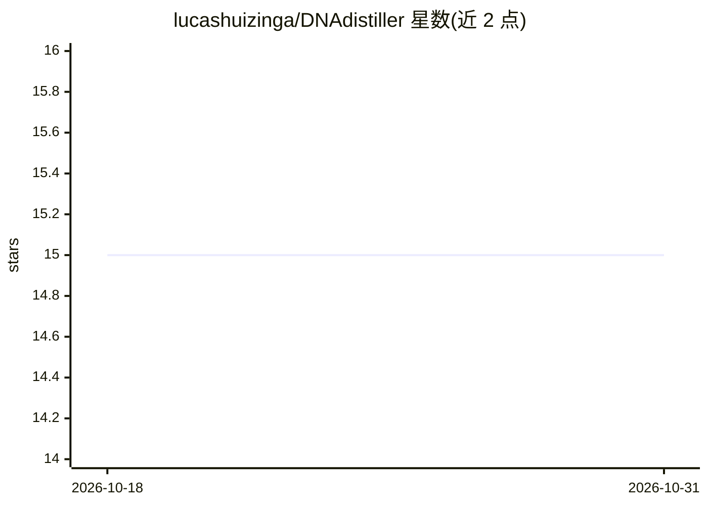

# lucashuizinga/DNAdistiller

⭐ 15 · Python · Apache-2.0 · 推送 2026-07-15 · [GitHub](https://github.com/lucashuizinga/DNAdistiller) · 个人维护

**本地解析消费级 DNA 文件生成 12 项长寿基因概要的 CLI 工具**

面向持有 23andMe/AncestryDNA 等原始数据的个人用户的本地命令行工具：读取基因芯片导出文件，从约 64 万个变异中提取 12 个与长寿/健康寿命相关的标记（含证据分级与引用），生成可粘贴给 LLM 讨论的简短概要，避免上传全基因组。提供 minimal/standard/full 三档披露层级，APOE 等敏感标记默认隐藏需显式开启；无网络代码，CI 禁止新增可联网的 import。不做诊断、祖源分析、多基因风险评分或罕见变异解读。

## 筛选速览

| 维度 | 判定 | 备注 |
|---|---|---|
| AI 角色 | `ai-knowledge` | 知识聚合/清单类 |
| 许可风险 | `permissive` | Apache-2.0 |
| 部署形态 | `library` | 以包/库形式分发 |
| 模型依赖 | — | README 未给出锁定关系 |
| 硬件要求 | — | 无带数字的原话,不猜 |
| 安装摩擦 | `low` | 无编译、无系统依赖或容器化 |
| 成熟度 | `idea` | |

## 能力要点

- 本地运行，无账号、无上传、无网络代码（CI 强制校验）
- 12 个标记均经 dbSNP 与论文核对，附证据分级与效应量
- 三档披露层级，APOE 等敏感标记需 --include-sensitive 才输出
- 支持 23andMe/AncestryDNA/MyHeritage/FamilyTreeDNA/Living DNA/VCF

## 适用场景

- 我想把 DNA 数据浓缩后拿去和 Claude/ChatGPT 讨论健康寿命，但不交出全基因组
- 了解哪些血液检测比基因型更值得做
- 控制分享给 LLM 的基因信息粒度

## 场景标签

 · 领域:生物信息/个人健康

## 证据(README 行号)

> L5: Turn a 23andMe or AncestryDNA file into a short, longevity-focused profile you can actually discuss with an LLM, wit
> L7: Runs locally. No account, no upload, no network code.
> L16: Paste that into Claude or ChatGPT. Keep the other 640,000 variants to yourself.
> L26: DNAdistiller reads the file on your machine, pulls out a curated set of variants that bear on longevity and healths

## 星数曲线

2026-10-18 15 → 2026-10-31 15（+0）

---
*卡片 v1 · prompt 1.4 · 生成 2026-10-30 · 置信度 mid · 依据 README sha `17aa9d14aa59` · [字段定义](../../DATASET.md)*
