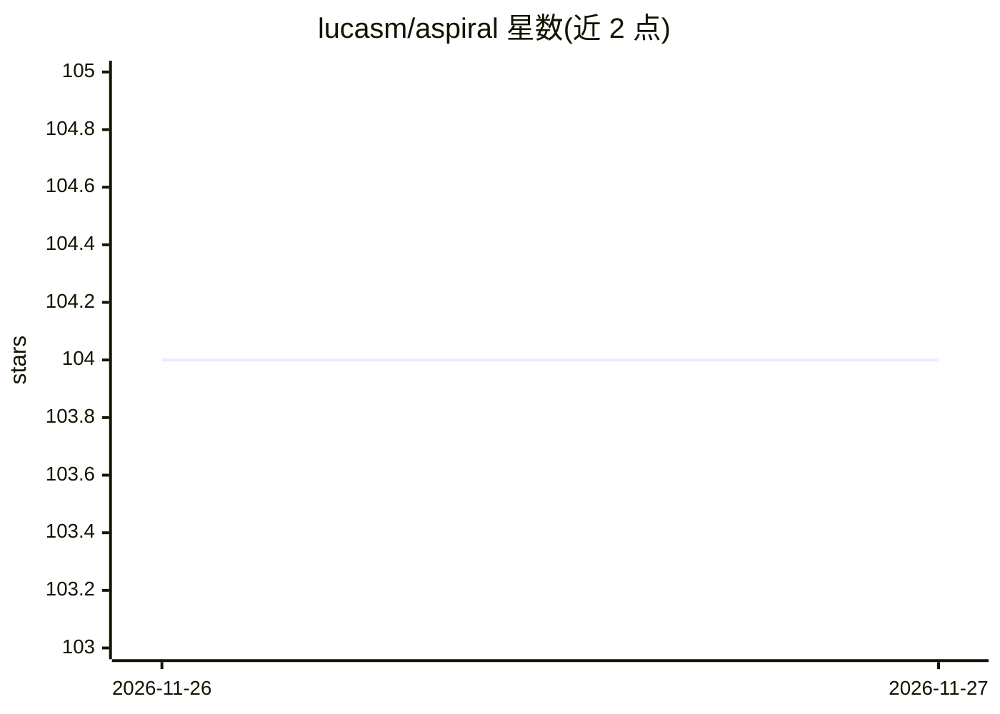

# lucasm/aspiral

⭐ 104 · TypeScript · AGPL-3.0 · 推送 2026-11-26 · [GitHub](https://github.com/lucasm/aspiral) · [官网](https://aspiral.app) · 个人维护

**面向用户的多源聚合搜索门户，覆盖 Web 与 AI 内容**

开源搜索门户，可对同一检索词在多个来源上同时搜索，并展示每个来源的隐私、安全与碳足迹估计等级，帮助用户选择搜索渠道；还提供实时趋势、最新故事、自动补全、语音搜索与国际化（本地/国际来源），界面支持暗色主题、键盘导航与屏幕阅读器。搜索来源按流行度、开放获取、合规性标准筛选，不存储用户搜索。由 Lucas Maués 与社区维护，采用 AGPL-3.0-only 许可，README 未提供本地安装说明，仅有在线试用入口。

## 筛选速览

| 维度 | 判定 | 备注 |
|---|---|---|
| AI 角色 | `ai-enhanced` | 去掉 AI 部分产品仍成立 |
| 许可风险 | `viral` | AGPL-3.0 |
| 部署形态 | `None` |  |
| 模型依赖 | — | README 未给出锁定关系 |
| 硬件要求 | — | 无带数字的原话,不猜 |
| 安装摩擦 | `low` | 无编译、无系统依赖或容器化 |
| 成熟度 | — | 结构信号不足 |

## 能力要点

- 同一检索词跨多个来源的分散式搜索
- 按来源展示隐私、安全、碳足迹估计等级
- 实时趋势、故事、自动补全与语音搜索
- 无障碍支持（暗色主题/键盘导航/屏幕阅读器）

## 适用场景

- 同时对比多个搜索来源的结果
- 按隐私与碳足迹指标选择搜索渠道
- 发现身边实时趋势与新故事

## 场景标签

 · 领域:网络搜索工具

## 证据(README 行号)

> L16: Aspiral is an open source search portal for Web content and AI, based on trusted sources.
> L31: |**Protection**|View estimated level of Security, Carbon footprint and Privacy of selected search source|✅|

## 星数曲线

2026-11-26 104 → 2026-11-27 104（+0）

---
*卡片 v1 · prompt 1.4 · 生成 2026-11-26 · 置信度 mid · 依据 README sha `c7d52902ff6e` · [字段定义](../../DATASET.md)*
