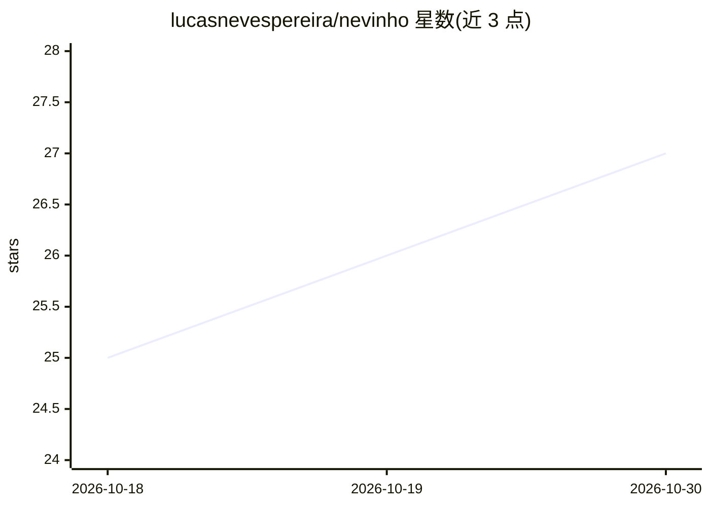

# lucasnevespereira/nevinho

⭐ 27 · Go · MIT · 推送 2026-10-23 · [GitHub](https://github.com/lucasnevespereira/nevinho) · 个人维护

**自托管的个人 AI agent，可经 Discord 或终端使用**

用 Go 编写的自托管个人 agent，单一二进制安装，提供两种入口：Linux VPS 上作为 Discord 后台服务（私聊对话、语音消息转写、定时任务），或作为终端内的编码 agent（会话检查点、目录级会话恢复、终端 hooks）。支持 Anthropic、OpenAI、Gemini、Groq、OpenRouter、Ollama 等 LLM 后端，并可通过 ChatGPT 计划登录。内置 bash、文件读写编辑、代码搜索、网页搜索与读取等工具，链式自动调用；敏感命令与路径写入需人工批准，配置以 AES-256-GCM 加密存储。语音消息使用本地 Whisper 模型转写，需 ffmpeg。

## 筛选速览

| 维度 | 判定 | 备注 |
|---|---|---|
| AI 角色 | `ai-native` | 本体是模型或模型工具 |
| 许可风险 | `permissive` | MIT |
| 部署形态 | `None` |  |
| 模型依赖 | local-ok | 支持本地模型 |
| 硬件要求 | — | 无带数字的原话,不猜 |
| 安装摩擦 | `medium` | 含编译或系统依赖之一 |
| 成熟度 | — | 结构信号不足 |

## 能力要点

- Discord bot 与终端客户端双入口，同一 agent 与配置
- 9 个内置工具（bash/文件编辑/网页搜索读取等）自动链式调用
- 支持 Anthropic/OpenAI/Gemini/Groq/OpenRouter/Ollama 多后端及 ChatGPT 计划登录
- 敏感命令扫描、路径审批、SSRF 防护等安全机制；本地 Whisper 语音转写

## 适用场景

- 在 VPS 上自托管一个随时通过 Discord 私聊联系的 AI 助手
- 在终端中作为编码 agent 处理文件与运行命令
- 让 agent 定时执行任务（如每早汇总新闻）并通过 DM 推送

## 场景标签

`编码 Agent` `AI 助手` · 领域:编码与开发

## 证据(README 行号)

> L9: A personal AI agent you self-host. Reach it from a Discord DM, or run it as a coding agent in your terminal. Support
> L10: Tools for bash, code search, web search, file editing, scheduled tasks.
> L105: The agent chains tools automatically. Ask it to "find the latest Go release" and it will search, read the page, an

## 星数曲线

2026-10-18 25 → 2026-10-30 27（+2）

---
*卡片 v1 · prompt 1.4 · 生成 2026-10-26 · 置信度 high · 依据 README sha `d1536ea91278` · [字段定义](../../DATASET.md)*
