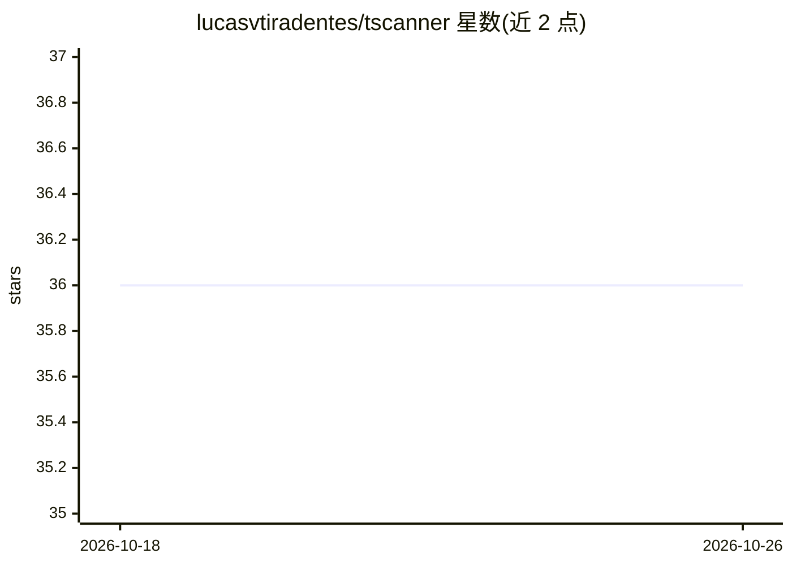

# lucasvtiradentes/tscanner

⭐ 36 · Rust · MIT · 推送 2026-06-03 · [GitHub](https://github.com/lucasvtiradentes/tscanner) · 个人维护

**面向 AI 生成代码时代的代码质量扫描器（编辑器/CLI/CI）**

用 Rust 引擎实现的代码质量扫描工具，提供 VS Code 扩展（实时侧栏显示问题）、npm CLI（可接入 pre-commit/lint-staged）与 GitHub Action（PR 评论汇总、单评论更新）三种使用方式。内置 38 条规则（类型安全、代码质量、Bug 预防），并支持正则、脚本（任意语言）与 AI 三类自定义规则，另有社区规则注册表。定位为约束 AI 生成代码符合项目规范；默认问题仅为警告，可配置为 error 以阻断 CI。

## 筛选速览

| 维度 | 判定 | 备注 |
|---|---|---|
| AI 角色 | `ai-enhanced` | 去掉 AI 部分产品仍成立 |
| 许可风险 | `permissive` | MIT |
| 部署形态 | `library` | 以包/库形式分发 |
| 模型依赖 | local-ok | 支持本地模型 |
| 硬件要求 | — | 无带数字的原话,不猜 |
| 安装摩擦 | `low` | 无编译、无系统依赖或容器化 |
| 成熟度 | — | 结构信号不足 |

## 能力要点

- 38 条内置规则 + 正则/脚本/AI 自定义规则
- Rust 引擎，数百文件扫描 <1s，带缓存
- VS Code 实时反馈 + CLI + GitHub Action PR 评论三种形态
- AI 规则用于检测传统 linter 难以覆盖的模式，并可导出问题供 AI 批量修复

## 适用场景

- 在编辑器和 PR 中拦截不符合团队规范的 AI 生成代码
- 为项目定义自定义正则/脚本规则并强制执行
- 用 AI 规则检测死代码、枚举候选等上下文相关模式

## 场景标签

 · 领域:开发工具/代码质量

## 证据(README 行号)

> L56: - **Your Rules, Enforced** - 38 built-in checks + define your own with regex, scripts, or AI
> L90: - **AI-powered quality**: Use AI rules to detect patterns that traditional linters miss, and let AI help fix AI-gen
> L281:  LLM-powered analysis for context-aware patterns (dead code, enum candidates, architectural violations)

## 星数曲线

2026-10-18 36 → 2026-10-26 36（+0）

---
*卡片 v1 · prompt 1.4 · 生成 2026-10-25 · 置信度 high · 依据 README sha `1709b8f757ee` · [字段定义](../../DATASET.md)*
