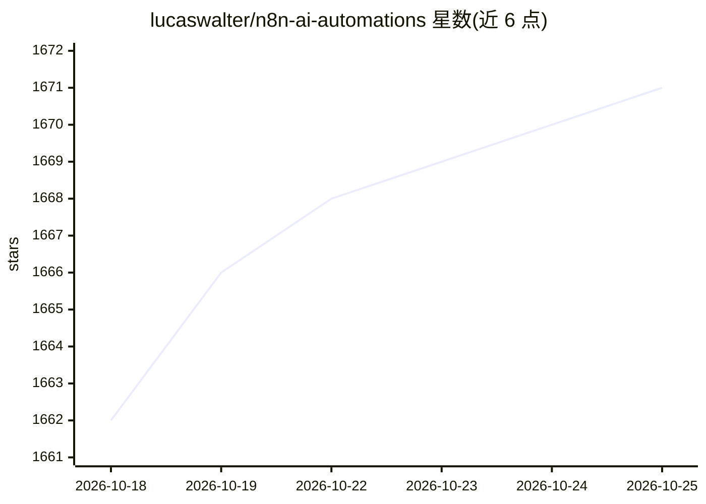

# lucaswalter/n8n-ai-automations

⭐ 1,672 · 推送 2026-03-02 · [GitHub](https://github.com/lucaswalter/n8n-ai-automations) · [官网](https://www.skool.com/ai-automation-mastery-group) · 组织维护

**n8n AI 工作流与 Agent 模板合集，面向 AI 自动化学习者**

由 The Recap AI（YouTube 频道）与 AI Automation Mastery 社区维护的 n8n 工作流、模板与 AI Agent 集合。内容为可导入 n8n 的 JSON 文件：涵盖营销团队语音 Agent、牙科诊所预约 Agent、WhatsApp 客服、Gmail 自动化、AI 网站开发 Agent，以及广告创意审计、SEO 文章、短视频脚本、UGC 视频生成等数十个工作流，调用 ElevenLabs、Firecrawl、Gemini、Sora 2 等外部 API。面向想学习或复用 n8n AI 自动化的用户。

## 筛选速览

| 维度 | 判定 | 备注 |
|---|---|---|
| AI 角色 | `ai-knowledge` | 知识聚合/清单类 |
| 许可风险 | `none` | — |
| 部署形态 | `None` |  |
| 模型依赖 | — | README 未给出锁定关系 |
| 硬件要求 | — | 无带数字的原话,不猜 |
| 安装摩擦 | `low` | 无编译、无系统依赖或容器化 |
| 成熟度 | — | 结构信号不足 |

## 能力要点

- 覆盖语音 Agent、客服、Gmail、网站开发等多类 n8n Agent 模板
- 数十个内容营销与广告创意自动化工作流（newsletter、短视频、UGC 视频）
- 每个条目附功能与所用服务的说明，以 JSON 文件提供

## 适用场景

- 导入现成模板快速搭建 n8n AI 自动化
- 学习多工具编排的 Agent 与工作流构建方式
- 为营销与内容生产场景寻找自动化参考实现

## 场景标签

`工作流自动化` `精选清单` · 领域:效率与自动化

## 证据(README 行号)

> L1: # The Recap AI + AI Automation Mastery n8n Workflows, Templates, and Agents
> L3: Collection of n8n agents, workflows, templates, and automations created and maintained by **The Recap AI** — Join ou

## 星数曲线

2026-10-18 1,662 → 2026-10-25 1,671（+9）

---
*卡片 v1 · prompt 1.4 · 生成 2026-10-21 · 置信度 high · 依据 README sha `985ba51ca4c0` · [字段定义](../../DATASET.md)*
