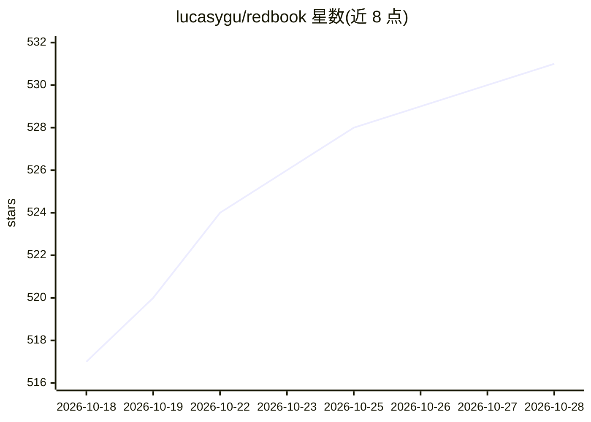

# lucasygu/redbook

⭐ 531 · TypeScript · MIT · 推送 2026-09-12 · [GitHub](https://github.com/lucasygu/redbook) · [官网](https://lucas.do/zh/projects/redbook) · 个人维护 · 中文 README

**面向 AI agent 的小红书命令行工具：搜索、分析与发布**

Node.js 实现的小红书 CLI，通过读取 Chrome 浏览器 Cookie 认证（无官方 API Key），用 TypeScript 实现的签名算法调用非官方 API，支持搜索笔记、阅读内容、博主与竞品分析、爆款拆解、限流检测、收藏与评论管理、Markdown 渲染图文卡片、发布笔记（易触发验证码）。内置 13 个可组合分析模块，安装后自动注册为 Claude Code 技能，兼容 OpenClaw/ClawHub 生态，也可作为 npm 包编程调用。使用非官方 API，接口可能随时失效。

## 筛选速览

| 维度 | 判定 | 备注 |
|---|---|---|
| AI 角色 | `ai-ecosystem` | LLM/agent 周边工具 |
| 许可风险 | `permissive` | MIT |
| 部署形态 | `library` | 以包/库形式分发 |
| 模型依赖 | locked-api |  |
| 硬件要求 | — | 无带数字的原话,不猜 |
| 安装摩擦 | `low` | 无编译、无系统依赖或容器化 |
| 成熟度 | — | 结构信号不足 |

## 能力要点

- 浏览器 Cookie 认证 + TypeScript 签名算法调用非官方 API，无需 API Key
- 三层 Cookie 提取策略（SQLite 直读 / CDP 回退 / 手动传入）
- 13 个可组合分析模块：关键词矩阵、爆款拆解、限流检测、批量评论回复等
- 自动注册为 Claude Code 技能，兼容 OpenClaw/ClawHub，提供 npm 编程接口

## 适用场景

- 让 AI 助手自动完成小红书话题研究与竞品分析
- 运营者批量巡检 KOS/KOC 账号发帖与互动数据
- 从爆款笔记提取内容模板并生成图文卡片
- 检测笔记是否被隐形限流、按策略批量回复评论

## 场景标签

`网页抓取` `数据分析` · 领域:效率与自动化

## 证据(README 行号)

> L9: > 把这段话发给你的 AI 助手（Claude Code、Cursor、Codex、Windsurf、OpenClaw 等）：
> L236: ## AI 助手集成
> L266: 安装后在 OpenClaw 中可直接使用所有 `redbook` 命令。SKILL.md 同时兼容 Claude Code 和 OpenClaw 两个生态。

## 星数曲线

2026-10-18 517 → 2026-10-28 531（+14）

---
*卡片 v1 · prompt 1.4 · 生成 2026-10-21 · 置信度 high · 依据 README sha `245ade987a17` · [字段定义](../../DATASET.md)*
