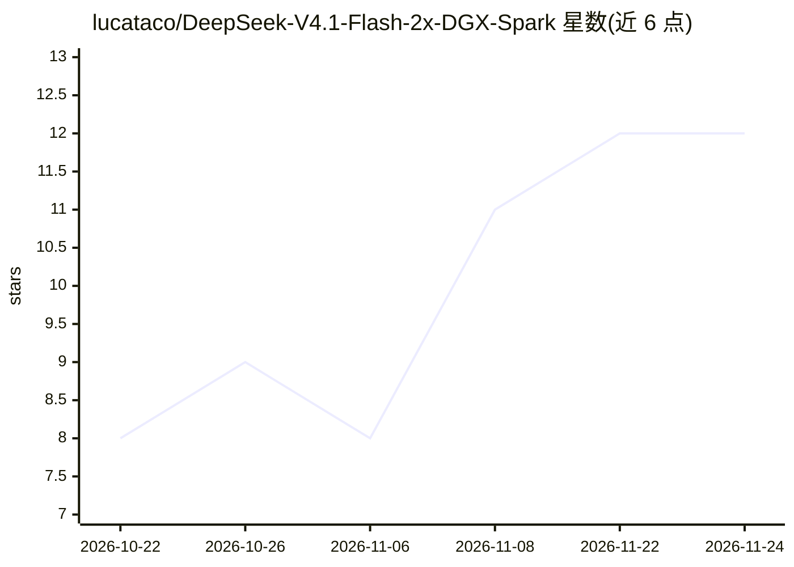

# lucataco/DeepSeek-V4.1-Flash-2x-DGX-Spark

⭐ 12 · Python · Apache-2.0 · 推送 2026-10-17 · [GitHub](https://github.com/lucataco/DeepSeek-V4.1-Flash-2x-DGX-Spark) · 个人维护

**在双 DGX Spark 节点上部署 DeepSeek-V4.1-Flash 的脚本集**

收录在两台 NVIDIA DGX Spark/GB10 节点（经 ConnectX-7 线缆组网）上以 TensorFold TP2 运行 DeepSeek-V4.1-Flash-1017 EXL3 量化包的全部脚本：聊天模板修复、preflight 检查、启停管理、Docker 化引擎，以及速度与质量测量复现流程。对外提供 OpenAI 兼容 API，支持 1M 上下文、4 并发、思考等级控制、工具调用与图片输入。仓库不含权重，运行需满足双节点硬件与约 540 GB 磁盘条件。

## 筛选速览

| 维度 | 判定 | 备注 |
|---|---|---|
| AI 角色 | `ai-ecosystem` | LLM/agent 周边工具 |
| 许可风险 | `permissive` | Apache-2.0 |
| 部署形态 | `self-host` | docker 或自建部署 |
| 模型依赖 | locked-api |  |
| 硬件要求 | — | 无带数字的原话,不猜 |
| 安装摩擦 | `low` | 无编译、无系统依赖或容器化 |
| 成熟度 | — | 结构信号不足 |

## 能力要点

- TensorFold TP2 引擎的 Docker 化部署脚本与聊天模板修复（install-chat-template.sh）
- OpenAI 兼容 API：reasoning_effort 七档思考等级、tools 与 image_url 支持
- 速度基准与质量评测（MMLU+GSM8K 对比 DeepSeek 官方 API）复现脚本
- preflight.sh 对双节点的只读环境检查

## 适用场景

- 在两台 DGX Spark 上本地部署 DeepSeek 大模型推理服务
- 复现双节点张量并行的吞吐与质量测量
- 为 Pi coding agent 配置本地 DeepSeek 模型通道

## 场景标签

`推理引擎` · 领域:训练与推理

## 证据(README 行号)

> L3: Serve DeepSeek-V4.1-Flash-1017 on two NVIDIA DGX Spark /
> L7: OpenAI-compatible API.
> L9: This repo holds the scripts, the one fix the 1017 release needs, and the speed and quality measurements, so you can

## 星数曲线

2026-10-22 8 → 2026-11-24 12（+4）

---
*卡片 v1 · prompt 1.4 · 生成 2026-11-18 · 置信度 mid · 依据 README sha `0e525fac17b4` · [字段定义](../../DATASET.md)*
