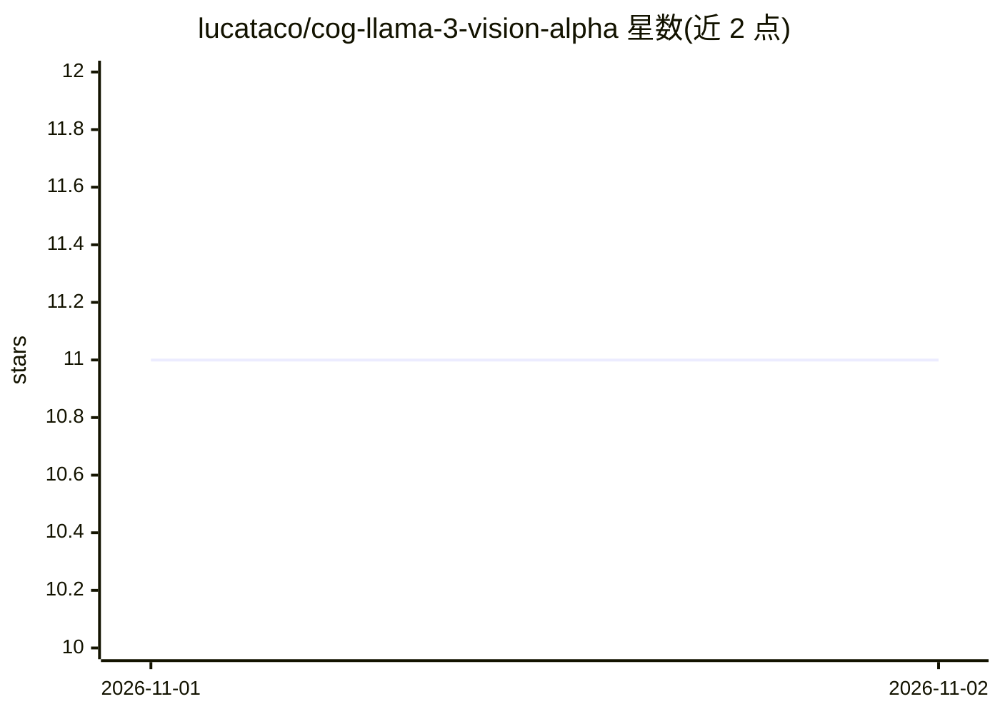

# lucataco/cog-llama-3-vision-alpha

⭐ 11 · Python · Apache-2.0 · 推送 2026-10-31 · [GitHub](https://github.com/lucataco/cog-llama-3-vision-alpha) · [官网](https://replicate.com/lucataco/llama-3-vision-alpha) · 个人维护

**Cog 封装的 Llama-3 视觉模型：图像+提示词生成描述**

将 qresearch/llama-3-vision-alpha 实现为 Cog 模型的封装仓库，供在 Replicate 等平台运行。用户通过 cog predict 命令输入一张图像和文本提示词，获得模型生成的图像描述输出。README 提供开发指引（按模型推送指南将模型推送到 Replicate）与基本用法示例。仓库代码采用 Apache License 2.0 许可，README 未记录其他功能细节。

## 筛选速览

| 维度 | 判定 | 备注 |
|---|---|---|
| AI 角色 | `ai-native` | 本体是模型或模型工具 |
| 许可风险 | `permissive` | Apache-2.0 |
| 部署形态 | `None` |  |
| 模型依赖 | — | README 未给出锁定关系 |
| 硬件要求 | — | 无带数字的原话,不猜 |
| 安装摩擦 | `low` | 无编译、无系统依赖或容器化 |
| 成熟度 | — | 结构信号不足 |

## 能力要点

- 将 llama-3-vision-alpha 实现为 Cog 模型
- cog predict 命令输入图像与提示词进行预测
- 代码采用 Apache License 2.0

## 适用场景

- 在 Replicate 上运行 Llama-3 视觉描述模型
- 输入图像与提示词获取模型生成的描述

## 场景标签

`多模态` · 领域:感知与多模态

## 证据(README 行号)

> L1: # qresearch/llama-3-vision-alpha Cog Model
> L3: This is an implementation of qresearch/llama-3-vision-alpha as a Cog model.
> L13:  cog predict -i image=@frieren.jpg -i prompt="Describe the image"

## 星数曲线

2026-11-01 11 → 2026-11-02 11（+0）

---
*卡片 v1 · prompt 1.4 · 生成 2026-11-02 · 置信度 high · 依据 README sha `4e2828e2e4fa` · [字段定义](../../DATASET.md)*
