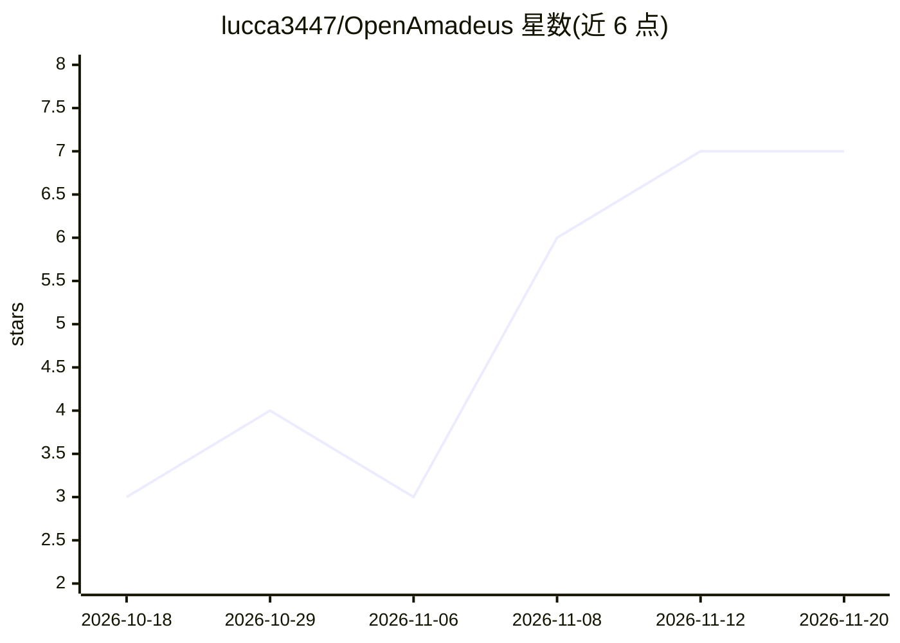

# lucca3447/OpenAmadeus

⭐ 7 · TypeScript · GPL-3.0 · 推送 2026-11-19 · [GitHub](https://github.com/lucca3447/OpenAmadeus) · 个人维护

**多模态 AI 伴侣运行时：复现 Steins;Gate 角色对话人格**

全栈模块化的三语（日/英/巴西葡语）多模态对话运行时，灵感来自《命运石之门0》的 Amadeus 系统。前端 React/TypeScript 提供视觉小说立绘、F1/F2 共振峰口型同步、Silero VAD 免提语音通话；后端 FastAPI 提供 4 级语音引擎级联（Qwen3-TTS/Kokoro/Edge-TTS/浏览器 Web Speech）、ChromaDB+SQLite 记忆检索的少样本 RAG，以及跨 Groq/Gemini/OpenRouter 的容错 LLM 路由与离线启发式模拟器兜底。立绘素材不随仓库分发，需用户自行提取。

## 筛选速览

| 维度 | 判定 | 备注 |
|---|---|---|
| AI 角色 | `ai-native` | 本体是模型或模型工具 |
| 许可风险 | `viral` | GPL-3.0 |
| 部署形态 | `desktop` | 安装包/桌面程序 |
| 模型依赖 | locked-api |  |
| 硬件要求 | `cpu-ok` | |
| 安装摩擦 | `low` | 无编译、无系统依赖或容器化 |
| 成熟度 | — | 结构信号不足 |

## 能力要点

- 4 级语音引擎级联：本地 CUDA GPU、离线 CPU、零下载云端与浏览器兜底
- Silero VAD v5 免提通话与真打断（barge-in），转写走 Groq Whisper Turbo
- 154 条三语 ChatML 对话样本与 36 条正典记忆索引入 ChromaDB 的动态少样本 RAG
- 三语 UI 与对话语言解耦，日文原声模式配 PT/EN 字幕

## 适用场景

- 本地部署一个带语音与立绘的视觉小说式 AI 伴侣
- 在 CPU 笔记本到 Colab GPU 不同硬件层级间切换语音引擎
- 研究多提供方 LLM 容错路由与低延迟 TTS 流式管线

## 场景标签

`语音合成` `RAG` `语音识别` `多模态` · 领域:内容生成

## 证据(README 行号)

> L3: A full-stack, modular **trilingual (Japanese / English / Brazilian Portuguese)** multimodal conversational AI runtim
> L61: - **Multi-Provider LLM Orchestration (`server/app/services/llm/`)**:
> L64: ## 💻 Universal Hardware Compatibility & Benchmarks

## 星数曲线

2026-10-18 3 → 2026-11-20 7（+4）

---
*卡片 v1 · prompt 1.4 · 生成 2026-11-20 · 置信度 high · 依据 README sha `8ff5435123c5` · [字段定义](../../DATASET.md)*
