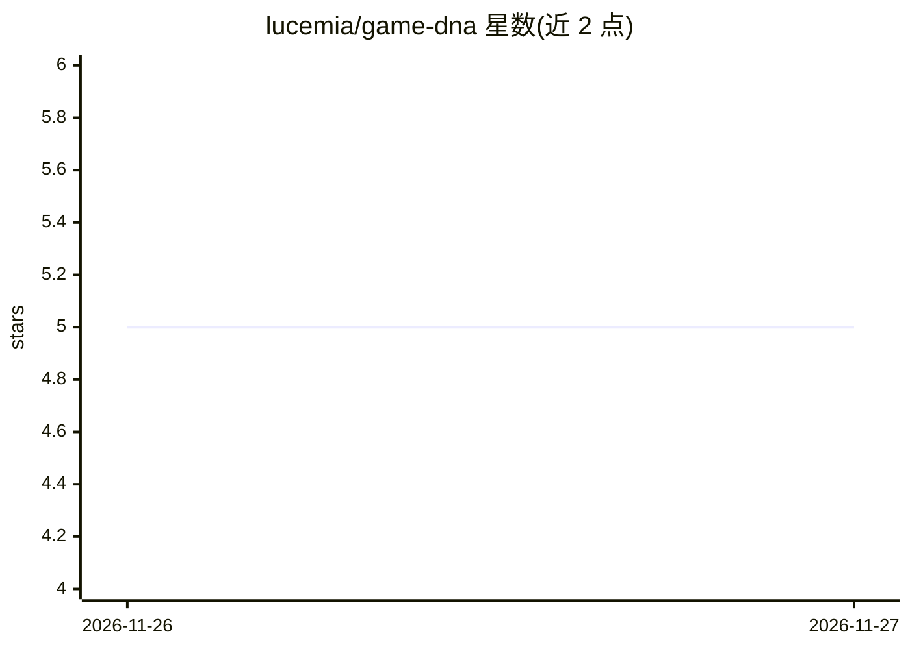

# lucemia/game-dna

⭐ 5 · HTML · MIT · 推送 2026-11-26 · [GitHub](https://github.com/lucemia/game-dna) · [官网](https://game-dna.pages.dev) · 个人维护

**给 coding agent 用的 102 个浏览器游戏元素：模块+提示词+演示**

面向使用 coding agent 开发浏览器游戏的用户：每个元素包含一个无依赖的 MIT JavaScript 模块、一段不超过 600 词的提示词（说明接入位置、禁改项与常见错误）、以及无浏览器的自检与可观看的验收检查，另有可玩的演示页面。82 个为可加入任意游戏的附加件，20 个以入门游戏形式提供的系统（战斗、地图流程、卡丁车等）。网站上的 Basket 支持选取多个元素、检查兼容性并生成合并提示词与模块 zip 包。

## 筛选速览

| 维度 | 判定 | 备注 |
|---|---|---|
| AI 角色 | `ai-knowledge` | 知识聚合/清单类 |
| 许可风险 | `permissive` | MIT |
| 部署形态 | `None` |  |
| 模型依赖 | — | README 未给出锁定关系 |
| 硬件要求 | — | 无带数字的原话,不猜 |
| 安装摩擦 | `low` | 无编译、无系统依赖或容器化 |
| 成熟度 | — | 结构信号不足 |

## 能力要点

- 102 个元素，每个含 MIT 无依赖 JS 模块 + ≤600 词提示词 + 自检/验收检查
- Basket 支持多元素组合：生成合并提示词与模块 zip
- 每个元素附可玩 live demo，部分演示使用 AI 生成美术
- 元素按战斗系统、效果手感、UI 文本、生成美术、3D/2.5D 等类别组织

## 适用场景

- 用 coding agent 给现有浏览器游戏添加打击数字、粒子等效果
- 按类别挑选战斗/UI/天气等元素并让 agent 接入
- 通过 Basket 组合多个元素一次性交给 agent 实现

## 场景标签

`编码 Agent` · 领域:编码与开发

## 证据(README 行号)

> L5: **102 game elements for your coding agent. Pick one, bring your browser game, and the agent wires it into your code,
> L36: Game DNA gives the agent three things instead of a guess:
> L39: - **a prompt** (at most 600 words) that says where to hook it into *your* game, what not to touch and the usual mis

## 星数曲线

2026-11-26 5 → 2026-11-27 5（+0）

---
*卡片 v1 · prompt 1.4 · 生成 2026-11-26 · 置信度 mid · 依据 README sha `bbf751065f61` · [字段定义](../../DATASET.md)*
