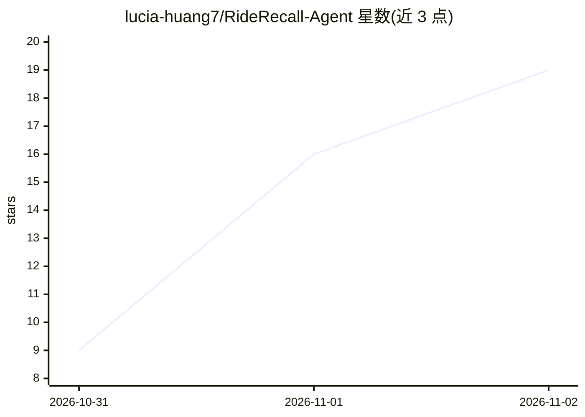

# lucia-huang7/RideRecall-Agent

⭐ 19 · Python · MIT · 推送 2026-11-01 · [GitHub](https://github.com/lucia-huang7/RideRecall-Agent) · 个人维护

**面向骑手的行程费用争议客服 Agent 应用（带记忆与证据引用）**

用 Python、FastAPI、Vue、SQLite、Chroma 与 MCP 构建的骑行客服应用：骑手可对扣费提出争议、更正先前陈述并申请专家复核；Agent 流水线识别请求、从 Chroma 检索政策、经只读 MCP 工具核查行程记录，回复附带政策引用。提供案例记忆与带版本声明的持久化存储、幂等请求与事务性写入，并有 Java 21/Spring Boot 后端参考实现。演示数据为模拟，无需 API key，仅建议在回环环境运行。

## 筛选速览

| 维度 | 判定 | 备注 |
|---|---|---|
| AI 角色 | `ai-native` | 本体是模型或模型工具 |
| 许可风险 | `permissive` | MIT |
| 部署形态 | `library` | 以包/库形式分发 |
| 模型依赖 | — | README 未给出锁定关系 |
| 硬件要求 | — | 无带数字的原话,不猜 |
| 安装摩擦 | `medium` | 含编译或系统依赖之一 |
| 成熟度 | — | 结构信号不足 |

## 能力要点

- 案例记忆恢复对话并维护带版本的骑手声明，更正不覆盖已记录行程事实
- RAG 从 Chroma 检索政策 + 只读 MCP 工具核查行程，回复含政策引用
- SQLite 单事务保存与请求去重，outbox 重试 Chroma 更新
- 2,000 条合成对话回放评估：严格离线工作流完成率 67%→100%

## 适用场景

- 处理乘客/骑手对扣费的争议与账目更正
- 需要政策证据引用的客服对话场景
- 将完整案例（对话、证据、声明历史）移交专家复核

## 场景标签

`RAG` `Agent 记忆` · 领域:Agent 开发

## 证据(README 行号)

> L5: A ride-support application built with Python, FastAPI, Vue, SQLite, Chroma and MCP. Riders dispute charges, correct 
> L18: - The agent pipeline identifies the request, retrieves policies from Chroma and checks trip records through read-on

## 星数曲线

2026-10-31 9 → 2026-11-02 19（+10）

---
*卡片 v1 · prompt 1.4 · 生成 2026-10-31 · 置信度 mid · 依据 README sha `955de1150612` · [字段定义](../../DATASET.md)*
