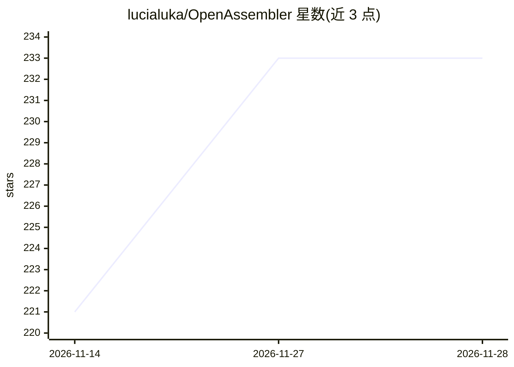

# lucialuka/OpenAssembler

⭐ 233 · Python · Apache-2.0 · 推送 2026-11-27 · [GitHub](https://github.com/lucialuka/OpenAssembler) · 个人维护

**把 GPU 内核与 Python 模型图编译为 NVIDIA SASS/cubin 的编译器**

面向 LLM 训练/推理场景的 GPU 编译器：接受 PTX、带 @kernel 标注的类型化 Python 内核、CUDA C/C++ 设备源与 Python 模型仓库，经 PTX 中间层由原生后端编译为 NVIDIA SASS 指令与 cubin，生产运行通过 CUDA 驱动加载。CLI 提供 inspect/compile/run/cnr 工作流，输出 manifest、cubin 与可读 SASS 清单。目标 A100/SM80，Python 3.12+，Linux/macOS；仅支持有界编译契约，不支持任意 Python 程序、不支持 SM80 以外架构；无实体硬件时可通过 Modal 或 SSH 后端执行。Apache 2.0 许可。

## 筛选速览

| 维度 | 判定 | 备注 |
|---|---|---|
| AI 角色 | `ai-ecosystem` | LLM/agent 周边工具 |
| 许可风险 | `permissive` | Apache-2.0 |
| 部署形态 | `None` |  |
| 模型依赖 | — | README 未给出锁定关系 |
| 硬件要求 | — | 无带数字的原话,不猜 |
| 安装摩擦 | `medium` | 含编译或系统依赖之一 |
| 成熟度 | `idea` | |

## 能力要点

- 支持 PTX、@kernel Python、CUDA C/C++、Python 模型图四类输入
- 自有后端完成指令选择、寄存器分配、依赖调度与机器码编码
- --backend 提供 local/modal/SSH 三种编译与执行通道
- cnr 命令一条完成编译+运行，--verify 校验输出

## 适用场景

- 为 LLM 训练/推理编译定制 GPU 内核
- 无实体 NVIDIA 硬件时经 Modal A100 编译执行
- 从 Python 模型仓库生成原生内核与 SASS 清单
- 对 CUDA C/C++ 设备源做编译路线实验

## 场景标签

 · 领域:编译器/ML基础设施

## 证据(README 行号)

> L5: **Compile customized GPU kernels and Python model graphs to native NVIDIA SASS and cubins.**
> L7: OpenAssembler targets **A100 / SM80**. Its native backend selects instructions,
> L31: openassembler compile examples/vector_add.py --backend [local, modal, user@host] --out-dir output/first-kernel --ve

## 星数曲线

2026-11-14 221 → 2026-11-28 233（+12）

---
*卡片 v1 · prompt 1.4 · 生成 2026-11-27 · 置信度 high · 依据 README sha `70b59f93fd47` · [字段定义](../../DATASET.md)*
