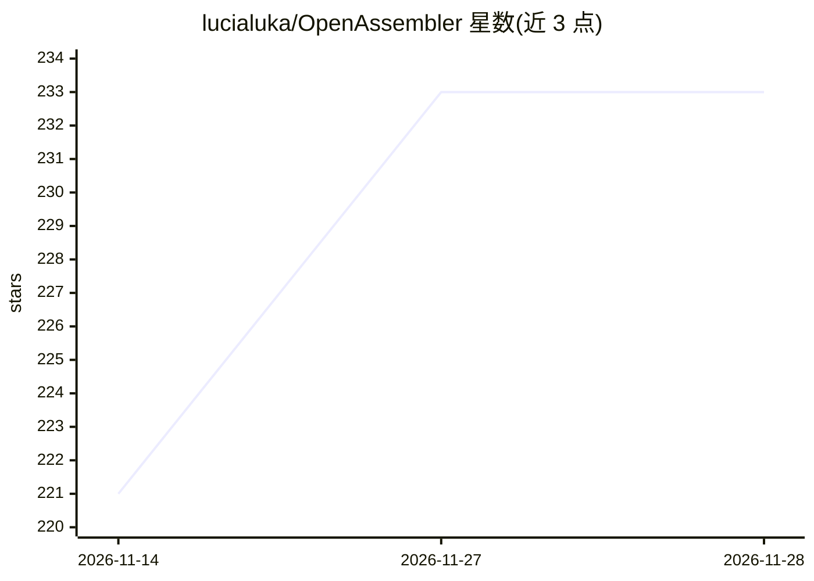

# lucialuka/OpenAssembler

⭐ 233 · Python · Apache-2.0 · 推送 2026-11-27 · [GitHub](https://github.com/lucialuka/OpenAssembler) · 个人维护

**把 Python/CUDA ML 代码编译为 NVIDIA SASS/cubin 的编译器**

OpenAssembler 是一个开源编译器，将自定义 GPU kernel（PTX、@kernel 标注的 Python、CUDA C/C++ 设备源码）和 Python 模型图编译为 NVIDIA SASS 与 cubin，经 CUDA 驱动加载执行。提供交互式 shell 与 inspect/compile/run/cnr 命令，后端可选 Modal、本地 Linux 或 SSH。限制明确：仅针对 A100/SM80，只支持有界编译契约，不支持的算子显式报错。Apache 2.0，要求 Python 3.12+。

## 筛选速览

| 维度 | 判定 | 备注 |
|---|---|---|
| AI 角色 | `ai-ecosystem` | LLM/agent 周边工具 |
| 许可风险 | `permissive` | Apache-2.0 |
| 部署形态 | `None` |  |
| 模型依赖 | — | README 未给出锁定关系 |
| 硬件要求 | — | 无带数字的原话,不猜 |
| 安装摩擦 | `medium` | 含编译或系统依赖之一 |
| 成熟度 | — | 结构信号不足 |

## 能力要点

- 支持 PTX、@kernel Python、CUDA C/C++、PyTorch 模型图四类输入
- 原生后端完成指令选择、寄存器分配、依赖调度与机器码编码
- 交互式 shell 提供 inspect/compile/run/cnr 工作流与 Tab 补全
- 后端可选 Modal 云 GPU、本地 Linux（需 CUDA 工具链）或 SSH

## 适用场景

- 为自己的 ML 仓库中的自定义 kernel 生成原生 GPU 机器码
- 无本地 NVIDIA 硬件时通过 Modal 在 A100 上编译验证
- 对 GEMM 等有界形状契约生成专用 kernel

## 场景标签

 · 领域:开发工具/编译器后端

## 证据(README 行号)

> L5: **Compile customized GPU kernels and Python model graphs to native NVIDIA SASS and cubins.**
> L7: OpenAssembler targets **A100 / SM80**. Its native backend selects instructions,
> L42: directory: `inspect`, `compile --backend modal --verify`, then

## 星数曲线

2026-11-14 221 → 2026-11-28 233（+12）

---
*卡片 v1 · prompt 1.4 · 生成 2026-11-28 · 置信度 high · 依据 README sha `ce2c0b8b4e24` · [字段定义](../../DATASET.md)*
