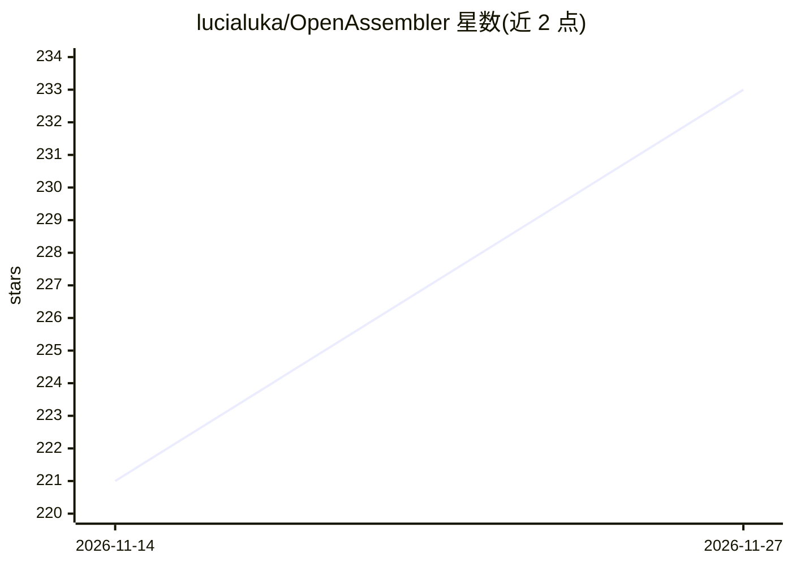

# lucialuka/OpenAssembler

⭐ 233 · Python · Apache-2.0 · 推送 2026-11-26 · [GitHub](https://github.com/lucialuka/OpenAssembler) · 个人维护

**将 Python/CUDA 代码编译为 NVIDIA SASS/cubin 的开源编译器**

OpenAssembler 是面向 A100/SM80 的编译器，将受支持的 Python 模型、GPU kernel、CUDA C/C++/C 与 PTX 源码编译为原生 NVIDIA SASS 与 cubin，自带指令选择、寄存器分配、调度与机器码编码。支持本地、SSH 与 Modal 云端三种后端执行，生成物包含 cubin/sass/manifest。面向 LLM 等神经网络的训练与推理场景；目前处于活跃开发阶段，原生模型编译限定于受支持的算子子集与显式契约，不支持任意训练脚本与动态 shape。

## 筛选速览

| 维度 | 判定 | 备注 |
|---|---|---|
| AI 角色 | `ai-ecosystem` | LLM/agent 周边工具 |
| 许可风险 | `permissive` | Apache-2.0 |
| 部署形态 | `None` |  |
| 模型依赖 | — | README 未给出锁定关系 |
| 硬件要求 | — | 无带数字的原话,不猜 |
| 安装摩擦 | `high` | 编译与系统依赖俱全 |
| 成熟度 | `idea` | |

## 能力要点

- 将 Python/CUDA C/C++/PTX 编译为原生 SASS 机器码与 cubin
- 支持本地、SSH、Modal 三种编译与运行后端
- 内置 Tensor Core GEMM 生成与 A100 autotuning
- 自动发现模型类与输入 shape，无需固定目录结构

## 适用场景

- 将 ML 仓库中的模型编译为 A100 原生 GPU 二进制
- 离线检查生成的 SASS 代码并做语义验证
- 为特定 shape 的 kernel 生成调优后的 GEMM

## 场景标签

 · 领域:编译器/GPU 基础设施

## 证据(README 行号)

> L5: **Compile Python models and GPU kernels to native NVIDIA SASS and cubins.**
> L7: OpenAssembler targets **A100 / SM80**, with its own instruction selection, register allocation, scheduling, and mach
> L87: host, or `--backend local` inside a Linux GPU terminal. Native kernel compilation

## 星数曲线

2026-11-14 221 → 2026-11-27 233（+12）

---
*卡片 v1 · prompt 1.4 · 生成 2026-11-25 · 置信度 high · 依据 README sha `7318eb042d14` · [字段定义](../../DATASET.md)*
