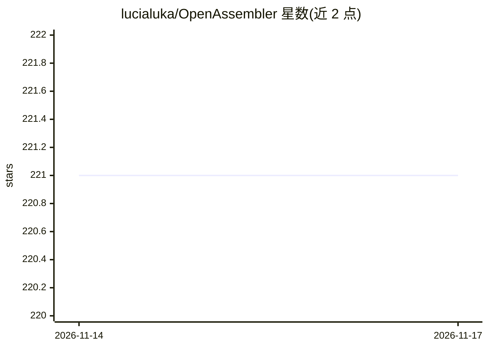

# lucialuka/OpenAssembler

⭐ 221 · Python · Apache-2.0 · 推送 2026-11-15 · [GitHub](https://github.com/lucialuka/OpenAssembler) · 个人维护

**将 Python 模型与 GPU 内核编译为 NVIDIA SASS/cubin 的开源编译器**

面向 A100/SM80 的编译器工具链，含指令选择、寄存器分配、调度与机器码编码。支持将 Python 模型仓库、typed @kernel Python 内核、CUDA C/C++/C 或 PTX 源编译为 SASS 与 cubin，产物可本地、SSH 或在 Modal 上运行。模型侧覆盖 CPU FP32 torch.nn.Module 的前向/反向/MSE/SGD 内核生成，算子集限于 linear、softmax、GELU、LayerNorm 等。自动设置不翻译任意训练脚本或自定义扩展。README 明确声明其结果不构成对 NVIDIA 或整体原生 transformer 训练加速的普遍优越性。

## 筛选速览

| 维度 | 判定 | 备注 |
|---|---|---|
| AI 角色 | `ai-ecosystem` | LLM/agent 周边工具 |
| 许可风险 | `permissive` | Apache-2.0 |
| 部署形态 | `library` | 以包/库形式分发 |
| 模型依赖 | — | README 未给出锁定关系 |
| 硬件要求 | — | 无带数字的原话,不猜 |
| 安装摩擦 | `high` | 编译与系统依赖俱全 |
| 成熟度 | `idea` | |

## 能力要点

- 自带指令选择、寄存器分配、调度与 SM80 机器码编码的原生后端
- 支持 Python/CUDA C/C++/PTX 输入，产物可本地、SSH 或 Modal 运行
- torch.nn.Module 捕获生成原生 forward/backward/MSE/SGD 内核
- Tensor Core GEMM 支持 tile/pointer/fragment 策略与 A100 自动调优

## 适用场景

- 将 Python 模型仓库编译为可在 A100 上运行的原生 cubin
- 生成并调优 Tensor Core GEMM 等内核
- 通过 Modal 或 SSH 在远程 GPU 上编译并执行模型

## 场景标签

`推理引擎` · 领域:训练与推理

## 证据(README 行号)

> L5: **Compile Python models and GPU kernels to native NVIDIA SASS and cubins.**
> L7: OpenAssembler targets **A100 / SM80**, with its own instruction selection, register allocation, scheduling, and mach
> L169: OpenAssembler lowers supported operations to PTX, selects native instructions,

## 星数曲线

2026-11-14 221 → 2026-11-17 221（+0）

---
*卡片 v1 · prompt 1.4 · 生成 2026-11-17 · 置信度 high · 依据 README sha `cb135b9691c3` · [字段定义](../../DATASET.md)*
