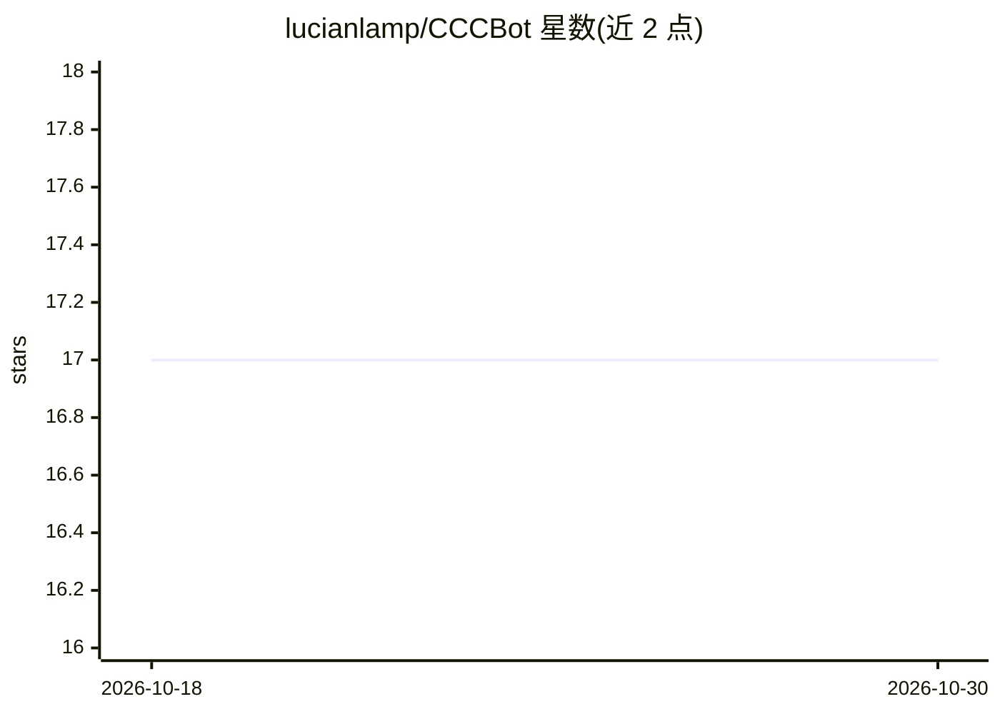

# lucianlamp/CCCBot

⭐ 17 · Shell · MIT · 推送 2026-03-30 · [GitHub](https://github.com/lucianlamp/CCCBot) · [官网](https://x.com/lucianlamp/status/2036089908071461298) · 个人维护 · 中文 README

**基于 Claude Code Channels 的长期自主 agent，接入 Telegram/Discord**

构建在 Claude Code Channels 插件之上的 OpenClaw 式自主 agent：将 Claude Code 会话连接到 Telegram 与 Discord（可同时启用），提供开机自启序列、JOBS.yaml 定时任务注册、心跳周期检查（仅发现问题时通知）、会话恢复与自动重启防护。通过 SOUL.md 配置人格与语气，通过 .claude/settings.json 选择权限模式（bypass/allowEdits），支持 Claude App 远程监控与干预。运行于 Claude Code 固定月费 OAuth 计划，无需按 token 付费。macOS/Linux 提供 curl 一键安装脚本，Windows 建议在 WSL 下运行。

## 筛选速览

| 维度 | 判定 | 备注 |
|---|---|---|
| AI 角色 | `ai-native` | 本体是模型或模型工具 |
| 许可风险 | `permissive` | MIT |
| 部署形态 | `None` |  |
| 模型依赖 | locked-api |  |
| 硬件要求 | — | 无带数字的原话,不猜 |
| 安装摩擦 | `low` | 无编译、无系统依赖或容器化 |
| 成熟度 | `idea` | |

## 能力要点

- 心跳监测与自动恢复的长期自主运行机制
- JOBS.yaml 定时任务开机自动注册（/ccc-jobs 管理）
- SOUL.md 人格/语气配置与权限模式选择（bypass/allowEdits）
- Claude App 远程监控、审批与干预，终端保持 headless

## 适用场景

- 让 Claude 在 Telegram/Discord 上作为常驻助手自主执行任务
- 通过手机上的 Claude App 监控并干预远程运行的 agent
- 为个人或项目设置定时自动化任务并接收异常通知

## 场景标签

`编码 Agent` · 领域:编码与开发

## 证据(README 行号)

> L11: An OpenClaw-style autonomous agent built on top of Claude Code Channels.
> L13: Channels connects Claude Code to Telegram and Discord — CCCBot extends that into a **self-sustaining autonomous age

## 星数曲线

2026-10-18 17 → 2026-10-30 17（+0）

---
*卡片 v1 · prompt 1.4 · 生成 2026-10-29 · 置信度 high · 依据 README sha `a0f9171cb8c2` · [字段定义](../../DATASET.md)*
