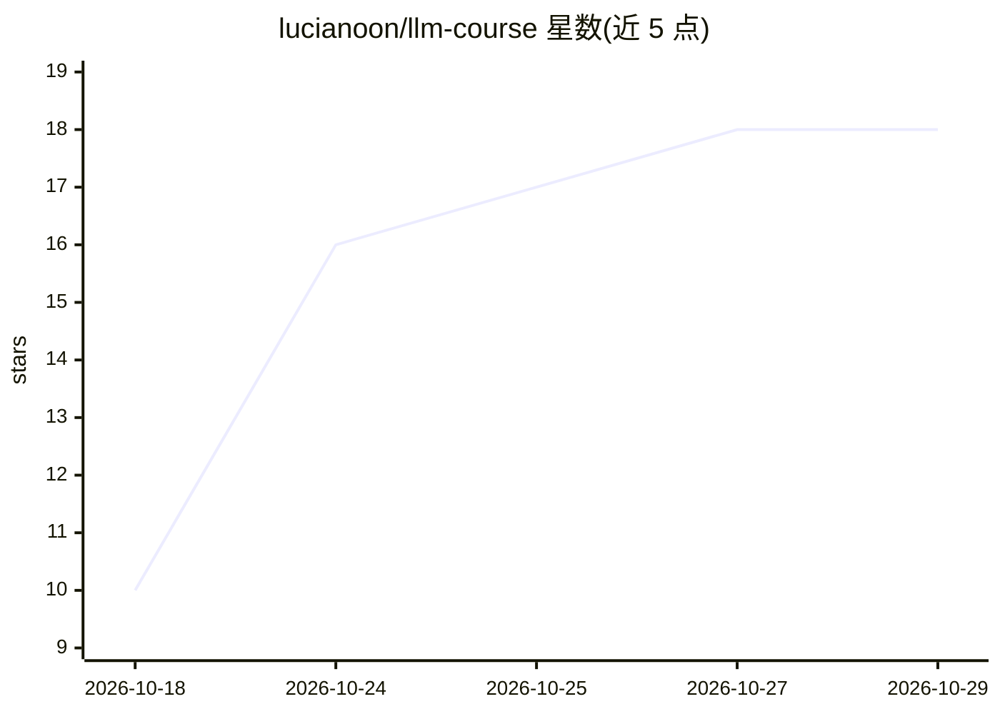

# lucianoon/llm-course

⭐ 18 · Python · Apache-2.0 · 推送 2026-10-27 · [GitHub](https://github.com/lucianoon/llm-course) · 个人维护

**葡萄牙语 LLM 工程课程：从零到生产的可复现实验**

面向从零基础到初级专业人士的开放式 LLM 工程课程，用葡萄牙语编写，共 Fase 0 加 19 个模块、36 个实验脚本。课程用 uv 安装并可在 CPU 上跑通全部路线（注意力、SFT、LoRA、RAG、评估、Agent、生产部署等），Mac (MLX) 与 NVIDIA GPU (CUDA) 路线用于在大模型上重复实验。每项实验声明声明环境、样本与限制，配证据登记、数据治理与公开评分表的认证项目。当前处于公开 beta 状态。

## 筛选速览

| 维度 | 判定 | 备注 |
|---|---|---|
| AI 角色 | `ai-knowledge` | 知识聚合/清单类 |
| 许可风险 | `permissive` | Apache-2.0 |
| 部署形态 | `None` |  |
| 模型依赖 | — | README 未给出锁定关系 |
| 硬件要求 | — | 无带数字的原话,不猜 |
| 安装摩擦 | `medium` | 含编译或系统依赖之一 |
| 成熟度 | `idea` | |

## 能力要点

- Fase 0 + 19 个模块、36 个实验脚本，全程可在 CPU 上运行
- MLX/CUDA 路线用于在大模型上重复同一实验问题
- 每个实验声明环境、样本与限制，配 EVIDENCIAS.md 证据登记
- 项目最终由他人按 README 复现，公开评分表认证

## 适用场景

- 系统学习从 transformer 原理到生产部署的 LLM 工程
- 在小机器上用 CPU 跑通 SFT 与 LoRA 微调实验
- 用可复现实验建立对训练与评估结论的验证习惯

## 场景标签

`教程课程` · 领域:学习与行业

## 证据(README 行号)

> L10: Um curso aberto para entender, customizar, avaliar e servir modelos de linguagem.
> L15: > **Fase 0 + 19 módulos · 36 scripts de laboratório**

## 星数曲线

2026-10-18 10 → 2026-10-29 18（+8）

---
*卡片 v1 · prompt 1.4 · 生成 2026-10-29 · 置信度 high · 依据 README sha `32ff0280db59` · [字段定义](../../DATASET.md)*
