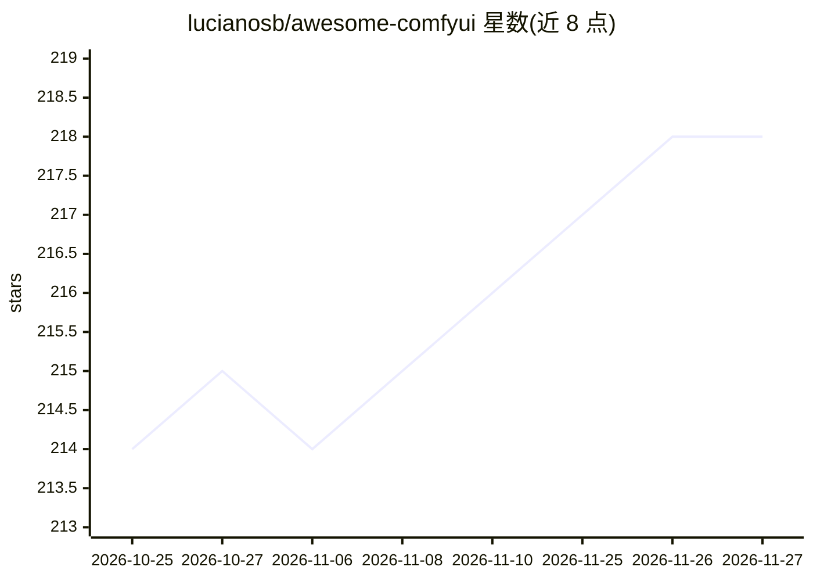

# lucianosb/awesome-comfyui

⭐ 218 · 推送 2026-11-24 · [GitHub](https://github.com/lucianosb/awesome-comfyui) · 个人维护

**ComfyUI 工具与资源的策展清单**

围绕 ComfyUI 生态的精选链接列表，按类别组织：主仓库与官方资源、Google Colab 笔记本、自定义节点与插件（如 ComfyUI Manager、WAS Node Suite、Impact Pack）、工作流模板与分享平台，以及基于 ComfyUI 构建的项目（前端界面、桌面应用、云 GPU 服务、MCP 服务器等）。条目多为名称加一句话说明，不含安装命令；采用 Creative Commons 许可。

## 筛选速览

| 维度 | 判定 | 备注 |
|---|---|---|
| AI 角色 | `ai-knowledge` | 知识聚合/清单类 |
| 许可风险 | `none` | — |
| 部署形态 | `None` |  |
| 模型依赖 | — | README 未给出锁定关系 |
| 硬件要求 | — | 无带数字的原话,不猜 |
| 安装摩擦 | `low` | 无编译、无系统依赖或容器化 |
| 成熟度 | — | 结构信号不足 |

## 能力要点

- 收录自定义节点与插件清单
- 收录工作流分享与诊断工具
- 收录基于 ComfyUI 的前端/桌面/云服务项目

## 适用场景

- 查找 ComfyUI 的自定义节点与插件
- 寻找工作流模板与分享平台
- 了解基于 ComfyUI 构建的周边项目

## 场景标签

`精选清单` · 领域:学习与行业

## 证据(README 行号)

> L2: An awesome and curated list of cool tools for ComfyUI.
> L9: ## Main ComfyUI Resources
> L64: ## Workflows

## 星数曲线

2026-10-25 214 → 2026-11-27 218（+4）

---
*卡片 v1 · prompt 1.4 · 生成 2026-11-26 · 置信度 high · 依据 README sha `058cedf7118e` · [字段定义](../../DATASET.md)*
