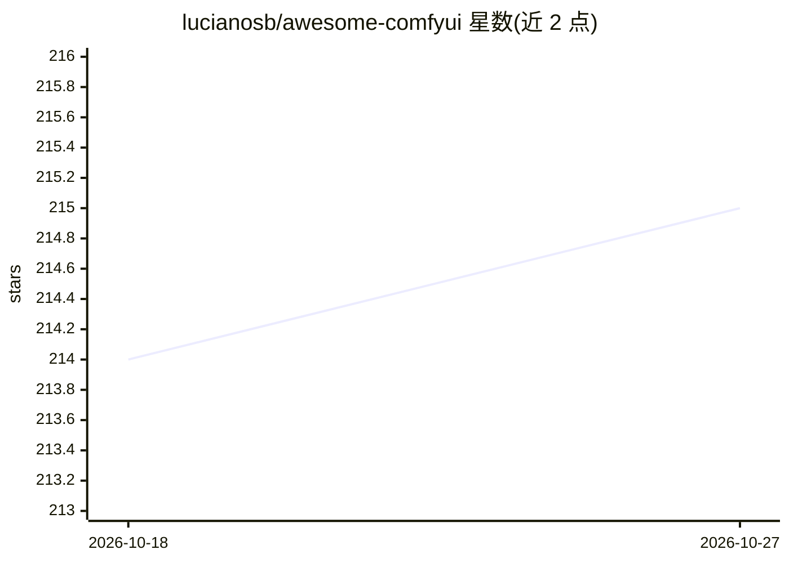

# lucianosb/awesome-comfyui

⭐ 215 · 推送 2026-09-18 · [GitHub](https://github.com/lucianosb/awesome-comfyui) · 个人维护

**ComfyUI 工具与插件策展清单：收录自定义节点、工作流与相关项目**

受 awesome list 形式启发的 ComfyUI 资源聚合清单：组织为官方资源、Colab 笔记本、自定义节点与插件（ComfyUI Manager、WAS Node Suite、Impact Pack、animatediff 等约 24 项）、工作流分享站与模板、基于 ComfyUI 的项目（前端界面、Krita 插件、云工作区）等板块。面向 Stable Diffusion 工作流用户与开发者，用于发现工具与工作流。以 Markdown 清单形式提供，无安装步骤。

## 筛选速览

| 维度 | 判定 | 备注 |
|---|---|---|
| AI 角色 | `ai-knowledge` | 知识聚合/清单类 |
| 许可风险 | `none` | — |
| 部署形态 | `None` |  |
| 模型依赖 | — | README 未给出锁定关系 |
| 硬件要求 | — | 无带数字的原话,不猜 |
| 安装摩擦 | `low` | 无编译、无系统依赖或容器化 |
| 成熟度 | — | 结构信号不足 |

## 能力要点

- 按类别组织：主资源/Colab/自定义节点/工作流/相关项目
- 收录约 24 个自定义节点与插件条目
- 收录工作流分享站点（Openart、Comfyworkflows 等）与模板

## 适用场景

- 为 ComfyUI 查找自定义节点与插件
- 发现可复用的 Stable Diffusion 工作流与模板
- 了解基于 ComfyUI 的界面与项目生态

## 场景标签

`精选清单` · 领域:学习与行业

## 证据(README 行号)

> L1: # awesome-comfyui
> L2: An awesome and curated list of cool tools for ComfyUI.

## 星数曲线

2026-10-18 214 → 2026-10-27 215（+1）

---
*卡片 v1 · prompt 1.4 · 生成 2026-10-22 · 置信度 high · 依据 README sha `b57ee90026b5` · [字段定义](../../DATASET.md)*
