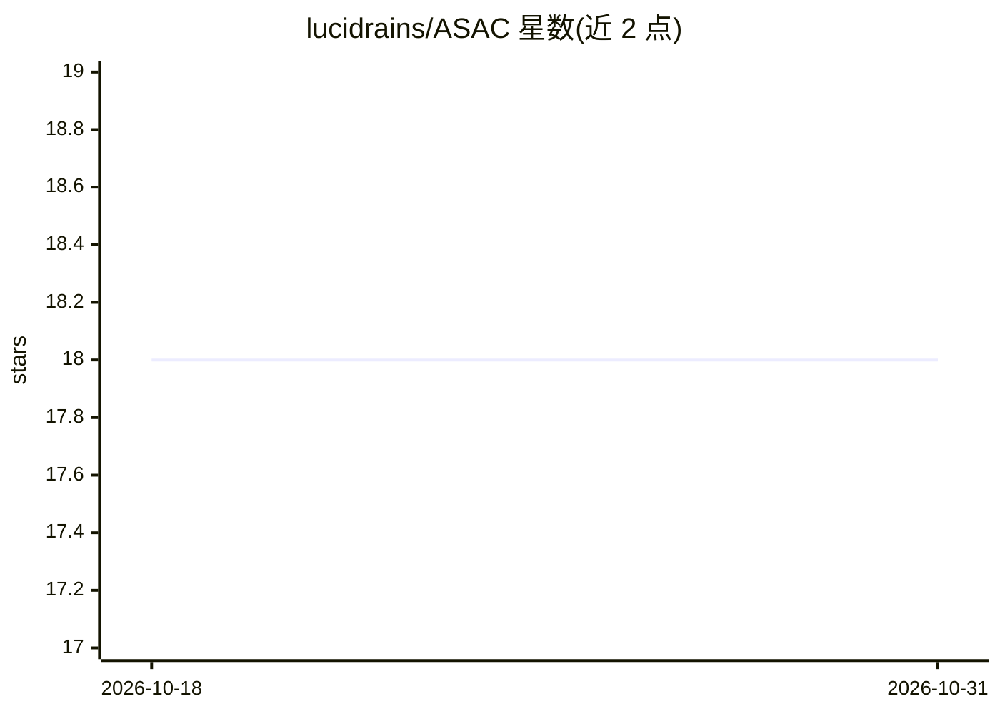

# lucidrains/ASAC

⭐ 18 · Python · MIT · 推送 2026-07-10 · [GitHub](https://github.com/lucidrains/ASAC) · 个人维护

**注意力模式注意力控制（ASAC）的论文官方实现（wip）**

实现论文《Attention Schema-based Attention Control (ASAC): A Cognitive-Inspired Approach for Attention Management in Transformers》所述方法，受认知科学中的注意力模式理论启发，用于 Transformer 的注意力管理。由 lucidrains（Phil Wang）编写，属研究代码实现，README 自标注 wip。仓库内容目前主要为论文实现代码与 BibTeX 引用信息，未给出安装或使用说明。

## 筛选速览

| 维度 | 判定 | 备注 |
|---|---|---|
| AI 角色 | `ai-native` | 本体是模型或模型工具 |
| 许可风险 | `permissive` | MIT |
| 部署形态 | `None` |  |
| 模型依赖 | — | README 未给出锁定关系 |
| 硬件要求 | — | 无带数字的原话,不猜 |
| 安装摩擦 | `low` | 无编译、无系统依赖或容器化 |
| 成熟度 | `idea` | |

## 能力要点

- 实现 ASAC 论文方法：注意力模式驱动的注意力控制
- 面向 Transformer 架构的注意力管理
- 仓库自标注 wip（进行中）

## 适用场景

- 复现或研究 ASAC 论文的注意力控制方法
- 在自建 Transformer 实验中尝试该注意力机制

## 场景标签

 · 领域:深度学习研究

## 证据(README 行号)

> L1: ## ASAC (wip)
> L3: Implementation of Attention Schema-based Attention Control (ASAC), A Cognitive-Inspired Approach for Attention Manag

## 星数曲线

2026-10-18 18 → 2026-10-31 18（+0）

---
*卡片 v1 · prompt 1.4 · 生成 2026-10-29 · 置信度 mid · 依据 README sha `2cc74c2b098e` · [字段定义](../../DATASET.md)*
