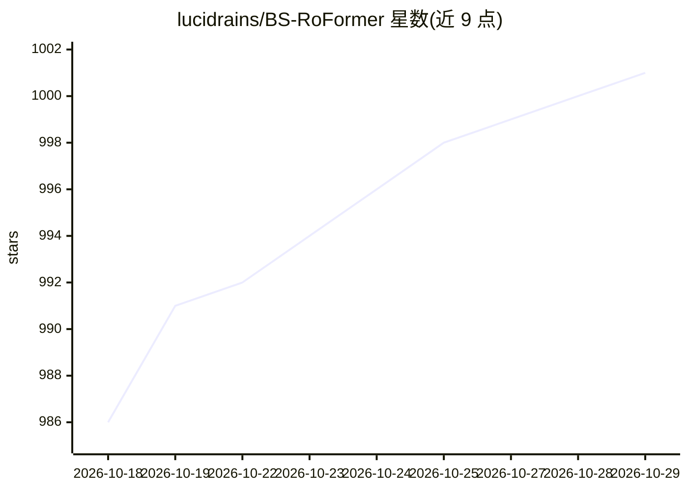

# lucidrains/BS-RoFormer

⭐ 1,001 · Python · MIT · 推送 2026-06-14 · [GitHub](https://github.com/lucidrains/BS-RoFormer) · 个人维护

**Band Split RoFormer 音乐源分离模型的 PyTorch 实现**

lucidrains 对字节跳动 AI Lab 提出的 Band Split RoFormer（基于轴向注意力与旋转位置编码的音乐源分离网络）的开源 PyTorch 实现。提供 BSRoformer、MelBandRoformer 与 FlowBSRoformer（Flow-Matching 变体，用预测噪声到目标的流替代掩码）三种模型类，支持立体声训练与多 stem 输出。面向希望复现或基于该论文进行音乐源分离研究与训练的开发者与科研人员，以 pip 包形式分发；本仓库只含模型实现，训练代码与权重由社区另仓开源。

## 筛选速览

| 维度 | 判定 | 备注 |
|---|---|---|
| AI 角色 | `ai-native` | 本体是模型或模型工具 |
| 许可风险 | `permissive` | MIT |
| 部署形态 | `library` | 以包/库形式分发 |
| 模型依赖 | — | README 未给出锁定关系 |
| 硬件要求 | — | 无带数字的原话,不猜 |
| 安装摩擦 | `low` | 无编译、无系统依赖或容器化 |
| 成熟度 | — | 结构信号不足 |

## 能力要点

- Band Split RoFormer 论文的 PyTorch 实现（轴向注意力 + 旋转位置编码）
- 附 MelBand RoFormer 与 Flow-Matching 变体 FlowBSRoformer
- 支持立体声训练与输出多个 stems

## 适用场景

- 复现或训练音乐源分离模型
- 在音频处理项目中集成 RoFormer 架构的分离开关
- 研究轴向注意力与旋转位置编码在音频任务中的应用

## 场景标签

 · 领域:音频/音乐源分离

## 证据(README 行号)

> L5: Implementation of Band Split Roformer, SOTA Attention network for music source separation out of ByteDance AI Labs. 
> L50: To use the Mel-Band Roformer proposed in a recent follow up paper, simply import `MelBandRoformer` instead

## 星数曲线

2026-10-18 986 → 2026-10-29 1,001（+15）

---
*卡片 v1 · prompt 1.4 · 生成 2026-10-21 · 置信度 high · 依据 README sha `3e6cbdea9d30` · [字段定义](../../DATASET.md)*
