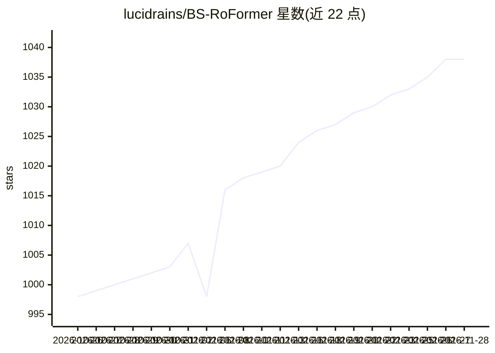

# lucidrains/BS-RoFormer

⭐ 1,038 · Python · MIT · 推送 2026-11-04 · [GitHub](https://github.com/lucidrains/BS-RoFormer) · 个人维护

**音乐源分离模型 BS-RoFormer 的 PyTorch 实现**

ByteDance AI Labs 提出的 Band Split RoFormer 音乐源分离网络的 PyTorch 实现：模型沿频率（多频带）与时间做轴向注意力，并使用旋转位置编码。支持立体声训练与多音轨输出；同时提供后续论文提出的 Mel-Band 变体及用 flow matching 替代掩码预测的 FlowBSRoformer。通过 pip 安装，README 给出三个变体的模型构建代码示例；模型权重需参考社区开源训练仓库，README 本身不含预训练权重与训练流程。

## 筛选速览

| 维度 | 判定 | 备注 |
|---|---|---|
| AI 角色 | `ai-native` | 本体是模型或模型工具 |
| 许可风险 | `permissive` | MIT |
| 部署形态 | `library` | 以包/库形式分发 |
| 模型依赖 | — | README 未给出锁定关系 |
| 硬件要求 | — | 无带数字的原话,不猜 |
| 安装摩擦 | `low` | 无编译、无系统依赖或容器化 |
| 成熟度 | — | 结构信号不足 |

## 能力要点

- BS-RoFormer 音频源分离网络实现（频率+时间轴向注意力）
- 支持立体声训练与多音轨输出
- 提供 MelBandRoformer 与 FlowBSRoformer 变体
- 模型构建代码示例，pip 安装

## 适用场景

- 把音乐拆分成人声/伴奏等多音轨
- 基于该架构训练自己的音频分离模型
- 对比 BS/Mel-Band/Flow 三种变体做音频研究

## 场景标签

 · 领域:音频/音乐信息处理

## 证据(README 行号)

> L5: Implementation of Band Split Roformer, SOTA Attention network for music source separation out of ByteDance AI Labs. 
> L38: $ pip install BS-RoFormer
> L43: ```python

## 星数曲线



2026-10-26 998 → 2026-11-28 1,038（+40）


---
*卡片 v1 · prompt 1.4 · 生成 2026-11-25 · 置信度 high · 依据 README sha `72daf0bdbb46` · [字段定义](../../DATASET.md)*
