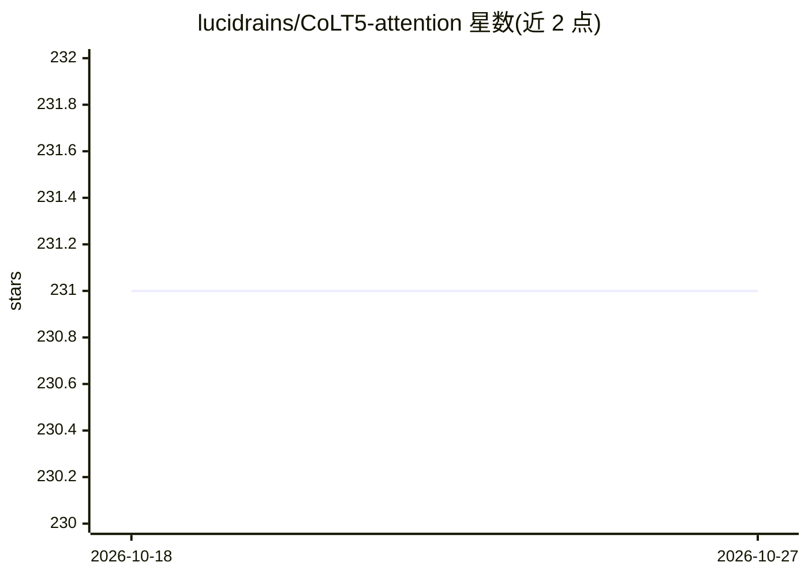

# lucidrains/CoLT5-attention

⭐ 231 · Python · MIT · 推送 2026-08-14 · [GitHub](https://github.com/lucidrains/CoLT5-attention) · 个人维护

**CoLT5 条件路由注意力的 PyTorch 实现，供研究者搭建长序列模型**

PyTorch 实现的 CoLT5 架构条件路由高效注意力：用坐标下降将 token 子集路由到 feedforward 与 attention 的重计算分支。提供自注意力、交叉注意力、自回归版本（滑窗机制）、图像特征图版本及 ConditionalRoutedViT，附可微分 topk 包装器。坐标下降通过 Triton 编写的 CUDA kernel 融合实现（前向较纯 PyTorch 快 18.5 倍），CPU 上回退到普通实现。作者声明路由归一化部分为即兴实现，迭代超过 20 时存在少量梯度差异。

## 筛选速览

| 维度 | 判定 | 备注 |
|---|---|---|
| AI 角色 | `ai-ecosystem` | LLM/agent 周边工具 |
| 许可风险 | `permissive` | MIT |
| 部署形态 | `library` | 以包/库形式分发 |
| 模型依赖 | — | README 未给出锁定关系 |
| 硬件要求 | — | 无带数字的原话,不猜 |
| 安装摩擦 | `medium` | 含编译或系统依赖之一 |
| 成熟度 | — | 结构信号不足 |

## 能力要点

- 坐标下降 token 路由的 CoLT5 条件注意力实现
- 自注意力/交叉注意力/自回归/图像特征图四种变体及 ConditionalRoutedViT
- Triton 融合 kernel 加速坐标下降，前向 18.5x、反向 7.2x，CPU 自动回退
- 可微分 topk 包装器

## 适用场景

- 搭建长序列 Transformer 时替换标准注意力
- 研究条件计算与高效注意力的路由机制
- 在高分辨率图像特征图上做路由注意力（可用于扩散模型）

## 场景标签

 · 领域:深度学习/模型组件

## 证据(README 行号)

> L5: Implementation of the conditionally routed efficient attention in the proposed CoLT5 architecture, in Pytorch.
> L7: They used coordinate descent from this paper (main algorithm originally from Wright et al) to route a subset of toke

## 星数曲线

2026-10-18 231 → 2026-10-27 231（+0）

---
*卡片 v1 · prompt 1.4 · 生成 2026-10-22 · 置信度 high · 依据 README sha `e861b980ccae` · [字段定义](../../DATASET.md)*
