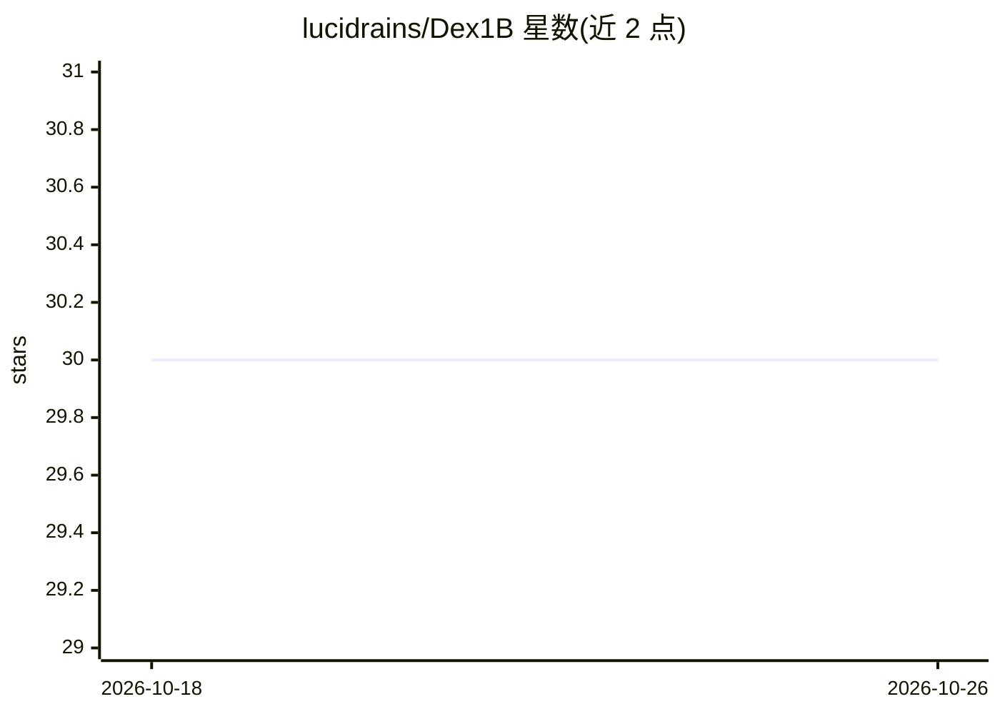

# lucidrains/Dex1B

⭐ 30 · Python · MIT · 推送 2026-07-27 · [GitHub](https://github.com/lucidrains/Dex1B) · 个人维护

**Dex1B 论文 DexSimple 生成模型与数据管线的 PyTorch 实现**

lucidrains 对 UCSD Ye 等人 Dex1B 论文（Learning with 1B Demonstrations for Dexterous Manipulation）中 DexSimple 生成模型与数据生成管线的实现。以 Python 包形式提供，支持手部姿态采样生成、基于局部物体点特征的去偏数据生成（associate_pose_with_object_point/debias_sample），以及对采样姿态的梯度后优化（post_optimize/HandGeometry）。README 标注 wip 状态，引用 RSS 2025 论文与 Point Transformer V3。

## 筛选速览

| 维度 | 判定 | 备注 |
|---|---|---|
| AI 角色 | `ai-native` | 本体是模型或模型工具 |
| 许可风险 | `permissive` | MIT |
| 部署形态 | `library` | 以包/库形式分发 |
| 模型依赖 | — | README 未给出锁定关系 |
| 硬件要求 | — | 无带数字的原话,不猜 |
| 安装摩擦 | `low` | 无编译、无系统依赖或容器化 |
| 成熟度 | `idea` | |

## 能力要点

- DexSimple 生成模型的手部姿态采样
- 基于局部物体点特征的去偏数据生成（debias_sample）
- 采样姿态的梯度后优化（post_optimize 与 HandGeometry）

## 适用场景

- 灵巧手操作研究中生成合成手部姿态数据
- 复现 Dex1B 论文的数据生成管线
- 对采样姿态做几何约束的后优化

## 场景标签

 · 领域:机器人/灵巧操作研究

## 证据(README 行号)

> L5: Implementation of **DexSimple**, the generative model and data generation pipeline from Dex1B: Learning with 1B Demo
> L16: import torch

## 星数曲线

2026-10-18 30 → 2026-10-26 30（+0）

---
*卡片 v1 · prompt 1.4 · 生成 2026-10-26 · 置信度 high · 依据 README sha `03a0688c86ac` · [字段定义](../../DATASET.md)*
