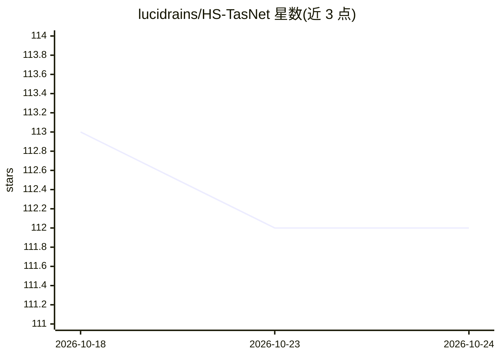

# lucidrains/HS-TasNet

⭐ 112 · Python · MIT · 推送 2026-10-13 · [GitHub](https://github.com/lucidrains/HS-TasNet) · 个人维护

**HS-TasNet 音乐源分离模型的 PyTorch 实现**

L-Acoustics 研究团队论文 'Real-time Low-latency Music Source Separation using Hybrid Spectrogram-TasNet' 的 PyTorch 实现，面向音频/深度学习开发者，提供模型构建、Trainer 封装、基于 MusDB 数据集的训练脚本（uv + accelerate 分布式）、wandb 实验跟踪与 pytest 测试。默认使用 PyTorch LSTM/GRU，可通过 rnn_klass 替换为 minGRU、ARGRC 等其他 RNN 结构，需遵守指定接口。以 pip 包形式分发，训练依赖需另跑 scripts/install.sh。

## 筛选速览

| 维度 | 判定 | 备注 |
|---|---|---|
| AI 角色 | `ai-native` | 本体是模型或模型工具 |
| 许可风险 | `permissive` | MIT |
| 部署形态 | `library` | 以包/库形式分发 |
| 模型依赖 | — | README 未给出锁定关系 |
| 硬件要求 | — | 无带数字的原话,不猜 |
| 安装摩擦 | `low` | 无编译、无系统依赖或容器化 |
| 成熟度 | — | 结构信号不足 |

## 能力要点

- 实时低延迟音乐源分离模型 HS-TasNet 的实现
- 提供 Trainer 封装与 MusDB 数据集训练脚本
- 支持 accelerate 分布式训练与 wandb 实验跟踪
- 可通过 rnn_klass 替换 LSTM/GRU 为 minGRU/ARGRC 等结构

## 适用场景

- 在 PyTorch 中训练或微调 HS-TasNet 音乐源分离模型
- 实时/低延迟场景下分离音乐音源
- 替换不同 RNN 结构做架构实验对比

## 场景标签

 · 领域:音频/AI 模型实现

## 证据(README 行号)

> L5: Implementation of HS-TasNet, "Real-time Low-latency Music Source Separation using Hybrid Spectrogram-TasNet", propos
> L71: The architecture defaults to using PyTorch's `LSTM` (or `GRU`), but you can easily substitute it for any other modu

## 星数曲线

2026-10-18 113 → 2026-10-24 112（-1）

---
*卡片 v1 · prompt 1.4 · 生成 2026-10-23 · 置信度 mid · 依据 README sha `877493021d20` · [字段定义](../../DATASET.md)*
