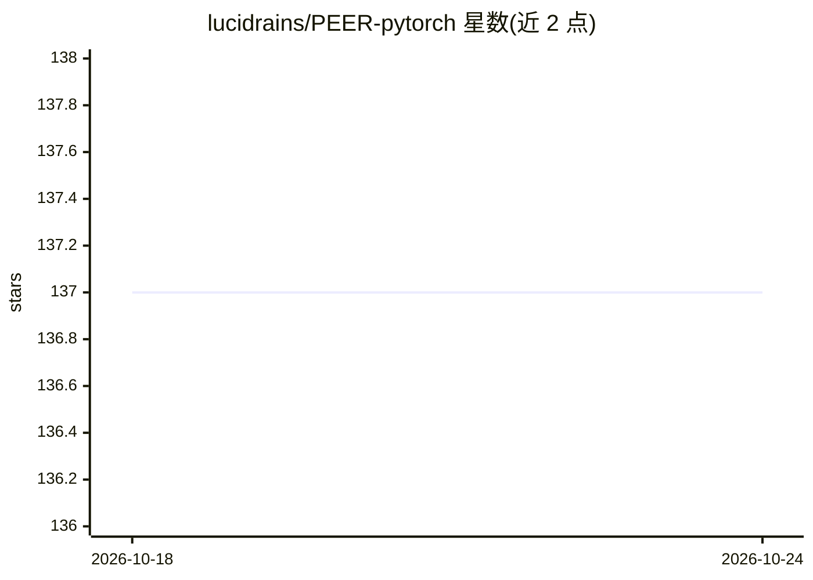

# lucidrains/PEER-pytorch

⭐ 137 · Python · MIT · 推送 2025-11-01 · [GitHub](https://github.com/lucidrains/PEER-pytorch) · 个人维护

**PEER 模块（百万专家混合）的 PyTorch 实现，供研究者复现论文**

对 DeepMind 论文《Mixture of A Million Experts》(Xu Owen He, 2024) 中 PEER 模块的独立 PyTorch 复现，属于 lucidrains 系列论文实现项目。以 pip 包形式提供 PEER 层，可直接嵌入 PyTorch 代码使用；README 含使用示例与三条 BibTeX 引用。给想实验 product-key 检索与稀疏专家结构的研究者与开发者使用。

## 筛选速览

| 维度 | 判定 | 备注 |
|---|---|---|
| AI 角色 | `ai-native` | 本体是模型或模型工具 |
| 许可风险 | `permissive` | MIT |
| 部署形态 | `library` | 以包/库形式分发 |
| 模型依赖 | — | README 未给出锁定关系 |
| 硬件要求 | — | 无带数字的原话,不猜 |
| 安装摩擦 | `low` | 无编译、无系统依赖或容器化 |
| 成熟度 | — | 结构信号不足 |

## 能力要点

- 实现论文中的 PEER（product-key 检索的百万专家混合）模块
- 通过 pip install PEER-pytorch 安装为 Python 包
- 提供 Python 使用示例与论文引用条目

## 适用场景

- 在 PyTorch 项目中实验 PEER 稀疏专家层
- 复现或扩展 Mixture of A Million Experts 论文方法
- 对比稀疏 MoE 结构的建模实验

## 场景标签

 · 领域:深度学习/模型实现

## 证据(README 行号)

> L7: Pytorch implementation of the PEER block from the Deepmind paper, Mixture of A Million Experts, by Xu Owen He.
> L12: $ pip install PEER-pytorch

## 星数曲线

2026-10-18 137 → 2026-10-24 137（+0）

---
*卡片 v1 · prompt 1.4 · 生成 2026-10-22 · 置信度 high · 依据 README sha `96c4d9c944fe` · [字段定义](../../DATASET.md)*
