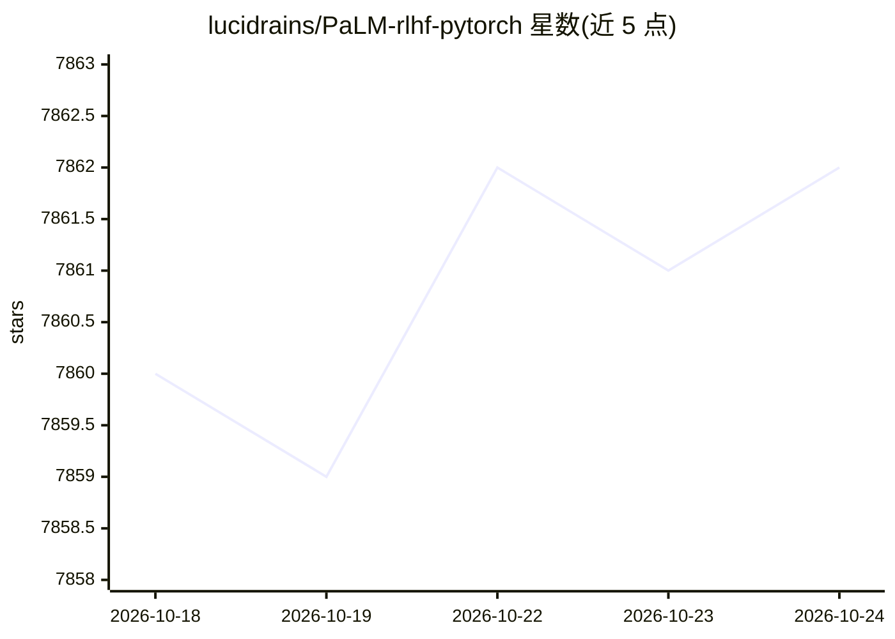

# lucidrains/PaLM-rlhf-pytorch

⭐ 7,863 · Python · MIT · 推送 2026-09-20 · [GitHub](https://github.com/lucidrains/PaLM-rlhf-pytorch) · 个人维护

**PyTorch 实现的 PaLM+RLHF 训练库，供研究者复现**

lucidrains 维护的 PyTorch 库，在 PaLM 架构上实现 RLHF 流程：依次训练 PaLM 自回归 Transformer、RewardModel（支持 LoRA 微调）、RLHFTrainer 完成强化学习微调。README 自述为 wip，FAQ 明确不含训练好的推理模型，仍需大量算力与数据。Todo 列出多项未完成功能（accelerate 集成、RLAIF 等），引用大量 RLHF/PPO 后续论文。供深度学习研究者使用，pip 安装。

## 筛选速览

| 维度 | 判定 | 备注 |
|---|---|---|
| AI 角色 | `ai-ecosystem` | LLM/agent 周边工具 |
| 许可风险 | `permissive` | MIT |
| 部署形态 | `library` | 以包/库形式分发 |
| 模型依赖 | — | README 未给出锁定关系 |
| 硬件要求 | — | 无带数字的原话,不猜 |
| 安装摩擦 | `low` | 无编译、无系统依赖或容器化 |
| 成熟度 | `idea` | |

## 能力要点

- PaLM 架构上的 RLHF 实现：PaLM + RewardModel + RLHFTrainer 三段式流程
- 奖励模型支持 LoRA 与非 LoRA 微调
- 集成 Flash Attention、LoRA 等技术并引用多篇后续论文

## 适用场景

- 研究者复现或实验 RLHF 训练流程
- 学习 PaLM + 奖励模型 + PPO 的代码结构
- 基于该库开展 RLHF 相关消融实验

## 场景标签

`强化学习` · 领域:训练与推理

## 证据(README 行号)

> L7: Implementation of RLHF (Reinforcement Learning with Human Feedback) on top of the PaLM architecture. Maybe I'll add 
> L41: First train `PaLM`, like any other autoregressive transformer

## 星数曲线

2026-10-18 7,860 → 2026-10-24 7,862（+2）

---
*卡片 v1 · prompt 1.4 · 生成 2026-10-20 · 置信度 high · 依据 README sha `ba8abbd28edf` · [字段定义](../../DATASET.md)*
