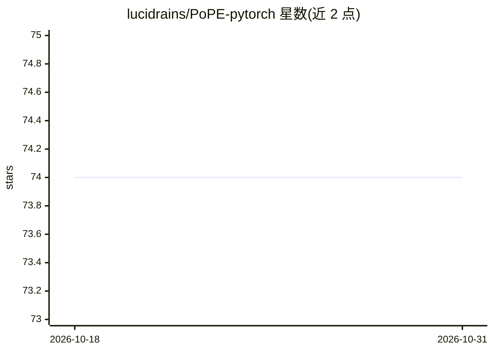

# lucidrains/PoPE-pytorch

⭐ 74 · Python · MIT · 推送 2026-06-21 · [GitHub](https://github.com/lucidrains/PoPE-pytorch) · 个人维护

**极坐标位置编码 PoPE 的 PyTorch 高效实现库**

对论文《Decoupling the What and Where With Polar Coordinate Positional Embeddings》（Gopalakrishnan 等，Schmidhuber 指导）提出的极坐标位置编码提供 PyTorch 高效实现与探索。提供 PoPE 模块、面向图像/视频多维场景的 AxialPoPE（可自动生成网格位置）、注意力相似度计算 compute_attn_similarity、融合 Flash Attention 的 flash_attn_with_pope，以及混合旋转/非旋转 token（如 ViT 的 CLS/register token）的支持。以 pip 包形式提供，供深度学习开发者集成到自有模型。

## 筛选速览

| 维度 | 判定 | 备注 |
|---|---|---|
| AI 角色 | `ai-native` | 本体是模型或模型工具 |
| 许可风险 | `permissive` | MIT |
| 部署形态 | `library` | 以包/库形式分发 |
| 模型依赖 | — | README 未给出锁定关系 |
| 硬件要求 | — | 无带数字的原话,不猜 |
| 安装摩擦 | `low` | 无编译、无系统依赖或容器化 |
| 成熟度 | — | 结构信号不足 |

## 能力要点

- PoPE 与多维度 AxialPoPE 模块，支持自动生成网格位置
- 融合 Flash Attention 的实现 flash_attn_with_pope
- compute_attn_similarity 注意力相似度计算
- 支持混合旋转与非旋转 token（CLS/register token 场景）

## 适用场景

- 在 ViT 等视觉模型中引入极坐标位置编码
- 图像/视频等多维输入的位置编码处理
- 复现与扩展 PoPE 论文的实验

## 场景标签

 · 领域:深度学习/计算机视觉

## 证据(README 行号)

> L5: Efficient implementation (and explorations) into polar coordinate positional embedding (PoPE) - from Gopalakrishnan 
> L24: For images, video, etc. where multiple dimensions are needed, you can use `AxialPoPE`. The feature dimension will b

## 星数曲线

2026-10-18 74 → 2026-10-31 74（+0）

---
*卡片 v1 · prompt 1.4 · 生成 2026-10-24 · 置信度 high · 依据 README sha `3220df67a1c8` · [字段定义](../../DATASET.md)*
