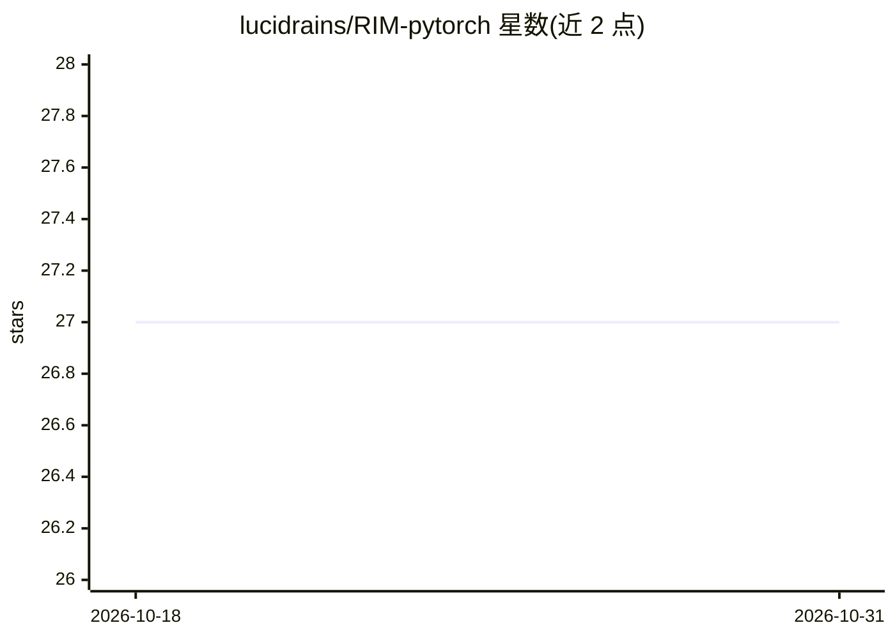

# lucidrains/RIM-pytorch

⭐ 27 · Python · MIT · 推送 2026-04-06 · [GitHub](https://github.com/lucidrains/RIM-pytorch) · 个人维护

**PyTorch 实现的 Recurrent Independent Mechanisms 研究代码库**

lucidrains 对 Goyal 等人（MILA）提出的 Recurrent Independent Mechanisms（RIM）的 PyTorch 实现，标注为 wip（进行中）的探索性项目。以 Python 包形式提供，可通过 pip 安装。README 主要包含安装命令与相关论文的 BibTeX 引用（RIM 原论文、TEIM、Attention Residuals、自监督 RL 深度网络），未展示用法示例或训练脚本细节。面向复现或扩展该研究方向的研究者与开发者。

## 筛选速览

| 维度 | 判定 | 备注 |
|---|---|---|
| AI 角色 | `ai-native` | 本体是模型或模型工具 |
| 许可风险 | `permissive` | MIT |
| 部署形态 | `library` | 以包/库形式分发 |
| 模型依赖 | — | README 未给出锁定关系 |
| 硬件要求 | — | 无带数字的原话,不猜 |
| 安装摩擦 | `low` | 无编译、无系统依赖或容器化 |
| 成熟度 | `idea` | |

## 能力要点

- Recurrent Independent Mechanisms 的 PyTorch 实现
- pip install RIM-pytorch 可直接安装
- README 收录 4 篇相关论文引用（含 RIM 原论文）

## 适用场景

- 复现 RIM 论文的机制与实验
- 基于独立机制思想开展注意力/深度学习研究
- 将 RIM 模块集成到自有 PyTorch 代码中

## 场景标签

 · 领域:深度学习/研究实现

## 证据(README 行号)

> L3: Explorations into Recurrent Independent Mechanisms, from Goyal et al. of MILA
> L10: $ pip install RIM-pytorch

## 星数曲线

2026-10-18 27 → 2026-10-31 27（+0）

---
*卡片 v1 · prompt 1.4 · 生成 2026-10-26 · 置信度 mid · 依据 README sha `2ef2b060b37c` · [字段定义](../../DATASET.md)*
