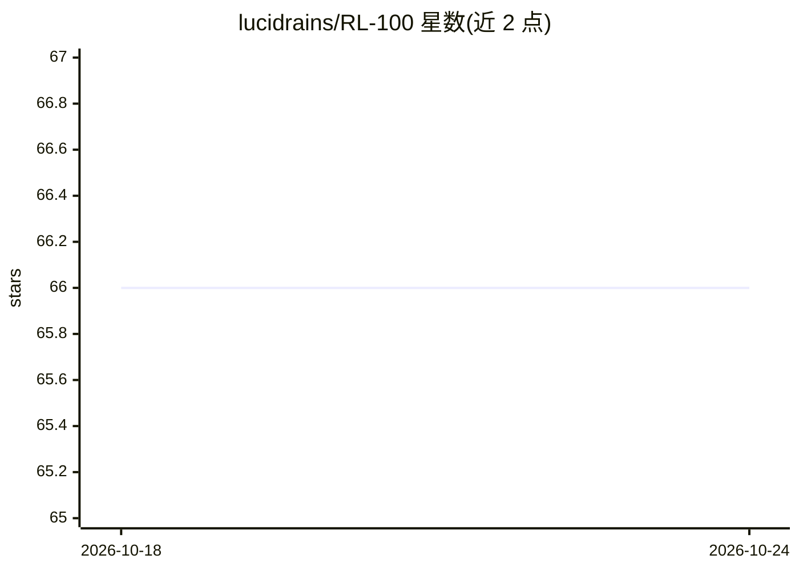

# lucidrains/RL-100

⭐ 66 · Python · MIT · 推送 2025-11-26 · [GitHub](https://github.com/lucidrains/RL-100) · 个人维护 · 中文 README

**RL-100 论文的机器人真世界强化学习实现**

lucidrains 对论文《RL-100: Performant Robotic Manipulation with Real-World Reinforcement Learning》的实现仓库。README 极简：仅项目名称、标注 wip（进行中）、一句话说明及论文引用条目，未提供安装方式、依赖说明、使用文档或示例。项目处于早期开发状态，论文作者来自中国机构团队。属机器人操作任务的真世界强化学习模型实现。

## 筛选速览

| 维度 | 判定 | 备注 |
|---|---|---|
| AI 角色 | `ai-native` | 本体是模型或模型工具 |
| 许可风险 | `permissive` | MIT |
| 部署形态 | `None` |  |
| 模型依赖 | — | README 未给出锁定关系 |
| 硬件要求 | — | 无带数字的原话,不猜 |
| 安装摩擦 | `low` | 无编译、无系统依赖或容器化 |
| 成熟度 | `idea` | |

## 能力要点

- RL-100 论文的官方风格第三方实现
- 标注 wip，处于进行中状态

## 适用场景

- 研究真世界强化学习机器人操作的复现
- 跟踪 lucidrains 对 RL-100 论文的实现进展

## 场景标签

`强化学习` · 领域:训练与推理

## 证据(README 行号)

> L3: ## RL-100 (wip)
> L5: Implementation of RL-100, Performant Robotic Manipulation with Real-World Reinforcement Learning, out of China

## 星数曲线

2026-10-18 66 → 2026-10-24 66（+0）

---
*卡片 v1 · prompt 1.4 · 生成 2026-10-24 · 置信度 low · 依据 README sha `c07458b6a8dd` · [字段定义](../../DATASET.md)*
