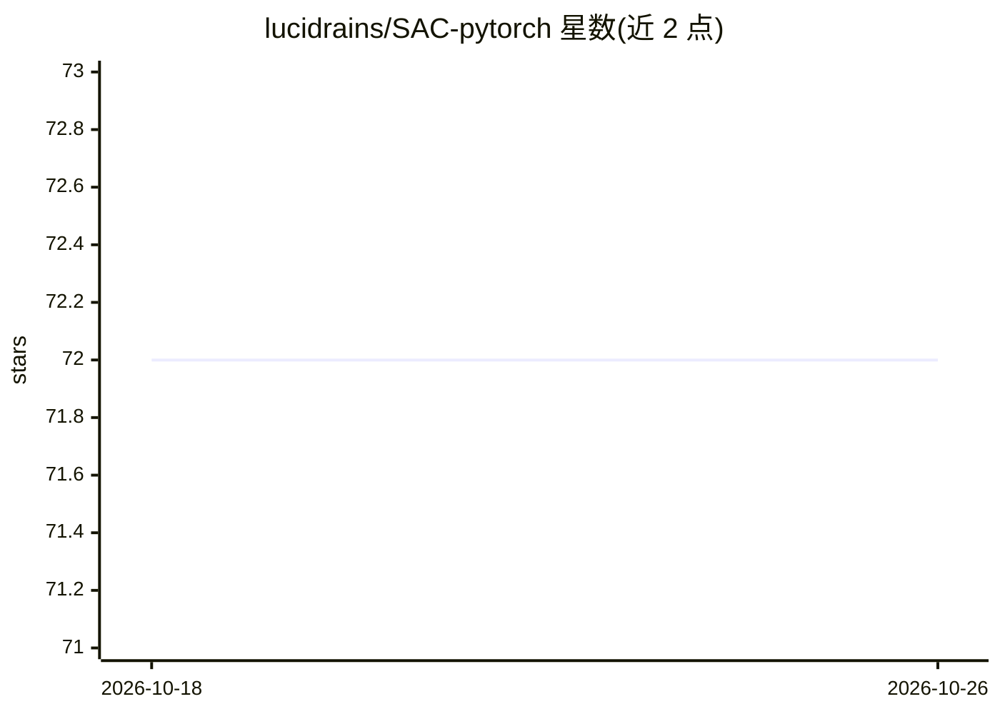

# lucidrains/SAC-pytorch

⭐ 72 · Python · MIT · 推送 2026-09-24 · [GitHub](https://github.com/lucidrains/SAC-pytorch) · 个人维护

**PyTorch 实现的 Soft Actor-Critic 强化学习算法库**

提供 Soft Actor-Critic（SAC）无模型强化学习算法的 PyTorch 实现及多篇论文的改进变体，覆盖 Dropout Q-Functions、塑性维持正则、SimBa 网络结构、分位数 Critic、Transformer-based Critic 等方向，每项改进均在 Citations 部分给出对应论文出处。面向强化学习研究与开发者，可通过 Python API 导入使用，附带的训练脚本以 uv run 运行 LunarLander 玩具示例。README 未列出 pip 安装命令与硬件要求。

## 筛选速览

| 维度 | 判定 | 备注 |
|---|---|---|
| AI 角色 | `ai-native` | 本体是模型或模型工具 |
| 许可风险 | `permissive` | MIT |
| 部署形态 | `None` |  |
| 模型依赖 | — | README 未给出锁定关系 |
| 硬件要求 | — | 无带数字的原话,不猜 |
| 安装摩擦 | `low` | 无编译、无系统依赖或容器化 |
| 成熟度 | — | 结构信号不足 |

## 能力要点

- SAC 算法的 PyTorch 实现
- 集成多篇论文的改进（Dropout Q-Functions、SimBa、ReLU²、Simplicial Embeddings 等）
- 提供 train_lunar.py 玩具训练脚本（uv run）

## 适用场景

- 在 PyTorch 中直接使用 SAC 训练连续控制任务
- 复现或对比 SAC 各改进论文的效果
- 作为强化学习研究的算法基线代码

## 场景标签

`强化学习` · 领域:训练与推理

## 证据(README 行号)

> L3: Implementation of Soft Actor Critic and some of its improvements in Pytorch. Interest comes from watching this lectu
> L15: uv run train_lunar.py

## 星数曲线

2026-10-18 72 → 2026-10-26 72（+0）

---
*卡片 v1 · prompt 1.4 · 生成 2026-10-24 · 置信度 mid · 依据 README sha `6c89a94147ad` · [字段定义](../../DATASET.md)*
