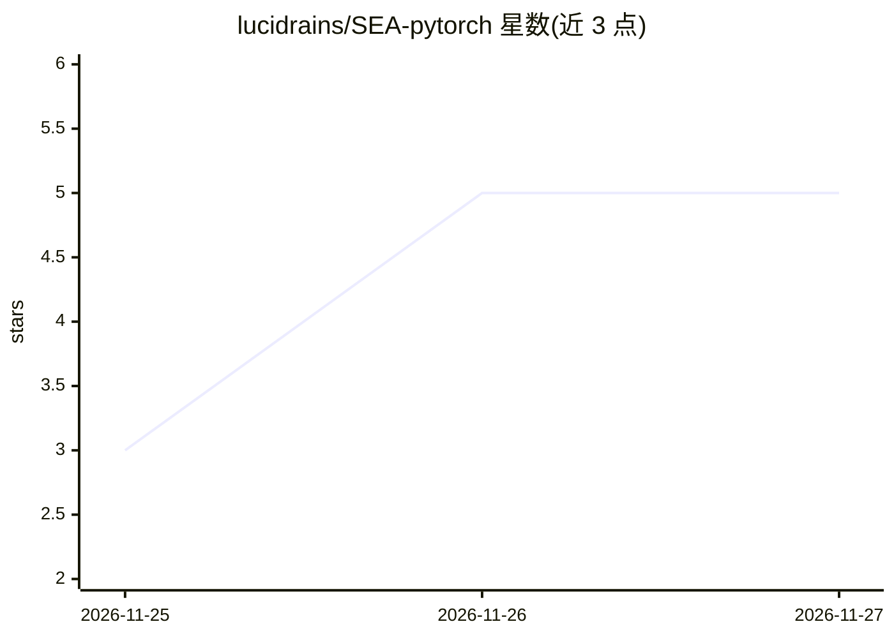

# lucidrains/SEA-pytorch

⭐ 5 · Python · MIT · 推送 2026-11-26 · [GitHub](https://github.com/lucidrains/SEA-pytorch) · 个人维护

**复现 Scaling Empowered Agents 论文的 PyTorch 实验代码（wip）**

lucidrains 维护的论文复现仓库，围绕 Catherine Ji 等人（Benjamin Eysenbach 组）的 Scaling Empowered Agents 研究，并附 Chongyi Zheng 等人的 MISL（互信息技能学习）论文引用。仓库标记为 wip（进行中），README 仅含标题与两条 BibTeX 引用，未提供安装、使用说明或结果展示。适合跟踪该论文实现进展的研究读者。

## 筛选速览

| 维度 | 判定 | 备注 |
|---|---|---|
| AI 角色 | `ai-native` | 本体是模型或模型工具 |
| 许可风险 | `permissive` | MIT |
| 部署形态 | `None` |  |
| 模型依赖 | — | README 未给出锁定关系 |
| 硬件要求 | — | 无带数字的原话,不猜 |
| 安装摩擦 | `low` | 无编译、无系统依赖或容器化 |
| 成熟度 | `idea` | |

## 能力要点

- 提供 Scaling Empowered Agents 论文的 PyTorch 探索性实现
- 附带 MISL 互信息技能学习论文的引用信息
- 仓库状态标注为 wip（开发中）

## 适用场景

- 跟进 Scaling Empowered Agents 论文的开源实现进展
- 研究 empowerment 与无监督技能学习时参考实现

## 场景标签

`科研工具` · 领域:学习与行业

## 证据(README 行号)

> L3: Explorations into Scaling Empowered Agents, from Catherine Ji et al. of Benjamin Eysenbach's group
> L8: @misc{ji2026scalingempoweredagents,

## 星数曲线

2026-11-25 3 → 2026-11-27 5（+2）

---
*卡片 v1 · prompt 1.4 · 生成 2026-11-24 · 置信度 low · 依据 README sha `acea12b83b4f` · [字段定义](../../DATASET.md)*
