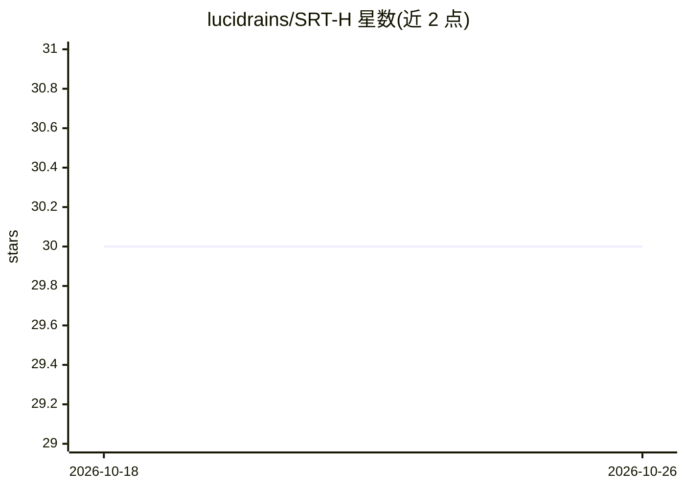

# lucidrains/SRT-H

⭐ 30 · Python · MIT · 推送 2026-10-04 · [GitHub](https://github.com/lucidrains/SRT-H) · 个人维护

**斯坦福/约翰霍普金斯 SRT-H 手术机器人模型架构实现**

lucidrains 对 Stanford / Johns Hopkins 提出的 SRT-H（A Hierarchical Framework for Autonomous Surgery via Language Conditioned Imitation Learning）模型架构的第三方实现，面向自主手术机器人场景，属于语言条件模仿学习与 Transformer 注意力机制的深度学习代码。README 标注 wip（开发中），当前内容仅为致谢与相关论文引用列表（SRT、ALOHA、ViTacFormer 等），未见安装命令、权重或使用示例。

## 筛选速览

| 维度 | 判定 | 备注 |
|---|---|---|
| AI 角色 | `ai-native` | 本体是模型或模型工具 |
| 许可风险 | `permissive` | MIT |
| 部署形态 | `None` |  |
| 模型依赖 | — | README 未给出锁定关系 |
| 硬件要求 | — | 无带数字的原话,不猜 |
| 安装摩擦 | `low` | 无编译、无系统依赖或容器化 |
| 成熟度 | `idea` | |

## 能力要点

- 实现 SRT-H 分层自主手术框架的模型架构
- 语言条件模仿学习路线，面向手术机器人
- README 明确标注 wip 开发中状态

## 适用场景

- 复现 SRT-H 论文的模型结构用于研究
- 在手术机器人模仿学习方向上做实验参考

## 场景标签

 · 领域:机器人/具身智能

## 证据(README 行号)

> L5: Implementation of the model architecture for SRT-H out of Stanford / Johns Hopkins
> L15:     title   = {SRT-H: A Hierarchical Framework for Autonomous Surgery via Language Conditioned Imitation Learning},

## 星数曲线

2026-10-18 30 → 2026-10-26 30（+0）

---
*卡片 v1 · prompt 1.4 · 生成 2026-10-26 · 置信度 mid · 依据 README sha `dfc80a139486` · [字段定义](../../DATASET.md)*
